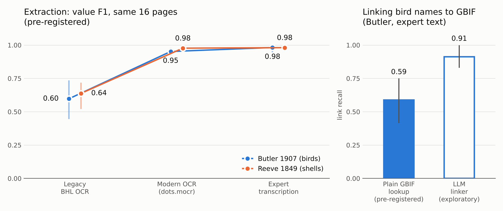

<div align="center">

# BioEvidenceBench

### Where does trustworthy data get lost between a 19th-century page and a database row?

Dekun Sun · University of Pennsylvania · [ai4s.fyi](https://ai4s.fyi)

Pilot · 2026

[**Preprint**](docs/preprint/preprint.pdf) ([web](docs/preprint/preprint.html), [source](docs/preprint.md)) · [**Results**](docs/results.md) · [Evaluation settings](docs/eval_settings.md) · [Product summary](docs/product.md) · [Poster](poster/poster.pdf) · [中文](#中文版-tldr)



<sub>Left: the same 16 locked test pages read as BHL's legacy OCR, a modern open OCR (dots.mocr) and the expert transcription; extraction value F1 with 95% page-bootstrap intervals (Claude Opus 5.5, pre-registered run). Right: of the bird names extracted correctly from the expert text, the share a plain GBIF lookup links to the right taxon (pre-registered) and the share an LLM linker does (exploratory). Generated from the run records by <code>src/plot_hero.py</code>.</sub>

</div>

---

## 1. TL;DR

[中文版](#中文版-tldr)

**BioEvidenceBench is a system-level evaluation of evidence-grounded scientific data extraction.
It follows one mention from a scanned 19th-century page to a database record (OCR, extraction,
evidence, entity resolution, scope, review) and measures how much reliability each step loses, to
decide where the next unit of effort should go. It is not an OCR benchmark: FineBooks already
scores OCR models.**

**The problem.** Millions of pages of historical natural history are scanned in the Biodiversity
Heritage Library (BHL). LLMs make turning them into data look easy. The hard part is making the
data trustworthy: every value traceable to the page, every error caught by someone. Should the next
investment go to better OCR, a better model, automated verification, entity resolution or human
review?

**The result in one line.** On these two English printed books, OCR was the first and largest loss
and modern OCR removed most of it (value F1 0.60–0.64 → 0.95–0.98); after that, the limits were
entity resolution (a plain GBIF lookup lost 14 of 34 correctly extracted names) and the definition
of what counts as a datum, not the extraction model.

| Step | How much is lost here | What wins it back |
| --- | --- | --- |
| 1. Page → text (OCR) | **Largest loss** on these books: value F1 0.60 / 0.64 on legacy OCR *(pre-registered)* | Modern OCR, LLM repair or reading the image (0.91–0.98); accept OCR on name preservation, not page error rate |
| 2. Text → mentions | Small once text is clean: 0.98 on the expert text *(pre-registered)*; four Claude models within 0.05 | Already won; Haiku costs about 1/15 of Opus |
| 3. Mentions → evidence | No accuracy cost *(pre-registered)*; its value is traceability, which accuracy does not measure | Line + verbatim quote on every value; image coordinates from OCR, not from a vision model |
| 4. Mentions → entities | **Largest loss on clean text**: 14 of 34 names lost at linking vs 0 before *(pre-registered)* | LLM linker 0.59 → 0.91; the rest is taxonomic judgment for curators |
| 5. What counts as a datum | Boundary conventions move botany F1 0.83 → 0.94; index pages were 16% of whole-book output | A written scope; one rule cut the review queue by 60% |
| 6. Review | Agreement is not correctness: 50 / 75 flagged errors on legacy OCR *(pre-registered)* | Route by text quality; sample-based QA; a second model to find misses |

- **How it was tested.** 22 pages from Butler 1907 (birds) and Reeve 1849 (shells), each as legacy
  BHL OCR, modern OCR and an expert transcription. 607 gold mentions labelled by hand before any
  model output, with a versioned guide; a second labeller on 5 pages (0.90 exact / 0.95 overlap).
  The model never rewrites text: it returns a line and a verbatim quote, and code slices the value.
  Pre-registered and frozen before the 16 test pages ran; everything decided afterwards is logged
  as exploratory.
- **Limits.** Two English books (1849, 1907) plus 8 botany pages. Other languages, layouts, eras,
  tables, plates and handwriting may fail OCR in entirely different ways; the books are public.

## 2. The finding

**OCR is where most reliability is lost on these books, and it is cheap to win back. After that,
trust is limited by entity resolution and by undefined scope, not by the extraction model.**

| Pre-registered (16 locked test pages, Claude Opus 5.5) | Butler 1907 | Reeve 1849 |
| --- | ---: | ---: |
| Value F1, legacy BHL OCR | 0.60 | 0.64 |
| Value F1, modern OCR (dots.mocr) | 0.95 | 0.98 |
| Value F1, expert transcription | 0.98 | 0.98 |
| Lenient F1 on legacy OCR (found the right place) | 0.93–0.97 | |
| Names lost at GBIF linking vs before it, expert text | 14 vs 0 of 34 | not measured |

On legacy OCR the model finds the right place but copies the misread text, which is why lenient
and value F1 differ so much. Of 163 gold mentions handled wrongly in some version, 151 were
OCR-sensitive (error tags by the labeller). Removing OCR as the cause leaves a pipeline whose
largest measured loss is linking printed names to today's taxonomy.

**Page error rate is the wrong OCR metric** *(exploratory)*. Across 22 OCR versions of the same
pages, value F1 tracks the share of gold names that survive OCR intact (Spearman 0.95 Butler, 1.00
Reeve) and not page CER (−0.07 / −0.62). Several OCR models under 0.5% page CER still kept only
57–80% of Butler's names. [OCR ladder](results/ocr_ladder/)

**The extraction model matters little; the linking model matters more** *(exploratory)*. Haiku,
Sonnet and Opus 5.5 and Fable 5.2 all score 0.93–0.98 on modern OCR and 0.58–0.65 on legacy OCR.
An LLM linker (name and context → accepted name → GBIF) raises Butler link recall from 0.59 to 0.91,
and there the model matters: Opus 0.91, Haiku 0.76. [Model comparison](results/model_comparison/) ·
[linkers](results/linking_variants/)

## 3. Same accuracy is not the same evidence

Three routes past bad OCR reach similar F1, but they do not leave equivalent, auditable evidence
*(exploratory)*:

| Route | Value F1 (Butler / Reeve) | Where the value comes from | What an auditor has to do |
| --- | --- | --- | --- |
| Modern OCR + quote-checked extraction | 0.95 / 0.98 | Sliced by code from the OCR text | Open the scan only to catch OCR misreads (none in 25 spot-checked values) |
| Legacy OCR + LLM repair | 0.96 / 0.91 | The model's reading; about 30% differ from the OCR text, each flagged | Check every flagged repair: 92% are right, so about 1 in 12 is a confident wrong reading |
| Page image only | 0.96 / 0.98 (value-bag scoring) | The model's transcription | Find every value on the scan; model-drawn boxes hit the right word only 67% / 40% |

Requiring a verbatim quote cost no accuracy and produced no measurable accuracy gain
*(pre-registered)*. That is a statement about the metric: both arms took values from the source by
code, so the test compared two forms of verification, not verification against none. Evidence's
value is traceability and audit cost; the next round should measure those directly.

## 4. How it was tested

The core questions were **registered and frozen before the test pages ran**; follow-ups decided
after unsealing are marked exploratory and logged in [`DEVIATIONS.md`](DEVIATIONS.md).

| Study | What it asks | Registration | Result |
| --- | --- | --- | --- |
| RQ1 OCR | How much does OCR quality change extraction? | [pre-registered](PREREGISTRATION.md) | [legacy → modern +0.34 on Reeve, modern → expert +0.005](results/analysis_test_main/) |
| RQ2 baseline | How much better is an LLM than gnfinder + regex? | [pre-registered](PREREGISTRATION.md) | [taxon 0.99–1.00 vs 0.54–0.64; mostly supports](results/analysis_test_main/) |
| RQ3 evidence | Does requiring a verbatim quote reduce unsupported output, at what recall cost? | [pre-registered](PREREGISTRATION.md) | [no recall cost; 0 unsupported values in both arms](results/analysis_test_main/) |
| RQ4 review | Can two models agreeing plus checks prioritise review? | [pre-registered](PREREGISTRATION.md) | [too few unflagged to compare; agreement is not correctness](results/analysis_test_main/) |
| E4 linking | Are names lost before linking or at linking? | [pre-registered](PREREGISTRATION.md) | [14 vs 0 of 34, supports](results/linking_test/) |
| Agreement | Do two labellers agree? | [pre-registered](PREREGISTRATION.md) | [0.90 exact, 0.95 overlap](results/agreement_independent/) |
| OCR ladder | Which OCR measure predicts extraction? | [exploratory](DEVIATIONS.md) | [name preservation, not page CER](results/ocr_ladder/) |
| Linker variants | Is the linking loss the linker's? | [exploratory](DEVIATIONS.md) | [mostly: LLM linker 0.59 → 0.91](results/linking_variants/) |
| Repair and vision | Can LLM repair or the page image stand in for re-OCR? | [exploratory](DEVIATIONS.md) | [yes for visible errors, not for fluent ones](results/exploratory_conditions/) |
| Review signals | Which cheap signal finds errors? | [exploratory](DEVIATIONS.md) | [on legacy OCR, 55% of errors in 25% of output](results/review_signals/) |
| Four Claude models | Does a cheaper or stronger model change the picture? | [exploratory](DEVIATIONS.md) | [no; Haiku about 1/15 of Opus's cost](results/model_comparison/) |
| Memorisation probe | Does repair come from memory of these books? | [exploratory](DEVIATIONS.md) | [no sign: fluent swaps restored 0 of 29](results/memorisation_probe/) |
| Image boxes | Can a vision model give image-level evidence? | [exploratory](DEVIATIONS.md) | [values yes, boxes 67% / 40%](results/vision_boxes/) |
| Whole book | Does it hold on 682 pages, and where should reviewers look? | [exploratory](DEVIATIONS.md) | [25 / 25 checked correct; index pages a scope gap](results/book_spotcheck/) |
| Botany case | Does the pattern hold on botany (PCAS 1898)? | [exploratory](DEVIATIONS.md) | [yes on names; joint authorities a new issue](results/pcas/) |

## 5. What this project cannot show

- **Not a rule for BHL.** Two English books printed in 1849 and 1907 plus 8 botany pages; 16 test
  pages, so intervals are wide. Book and OCR quality are confounded, so results are per book.
- **Not other material.** Other languages, layouts, print eras, tables, plates and handwritten
  records may fail OCR in entirely different ways. "OCR is no longer the main bottleneck" does not
  extend to them.
- **Not free of contamination.** BHL, the IMPACT transcriptions and PCAS are public and may be in
  the models' pre-training data. A probe found no sign of page memory in repair, which does not
  prove there is none.
- **Exploratory is exploratory.** Follow-ups were designed after seeing the test results and need
  a fresh test set before they count as findings.
- **One gold labeller,** a second on 5 pages. The botany adjudication was made after seeing model
  output, so both versions are reported.
- **No review-time study.** Review time comes from 9 timed spot-check items (median 30 s).
- Entity types are inspired by NHM's BHL prototype, but our scores are not comparable to NHM's.

## 6. How the plan was frozen

The labelling guide went through ten versions; every version and its reasons are in
[`ANNOTATION_GUIDE.md`](ANNOTATION_GUIDE.md). The prompt was fixed at guide v0.6
(`p4-guide-v0.6`); rules found later on test pages went into the guide and the gold, never into the
prompt, and scores are reported with and without them. Gold, prompt, scorer and analysis code were
hashed into [`FREEZE.json`](FREEZE.json) before the test pages ran; test outputs were sealed when
they arrived, and `src/unseal.py` refuses to open them unless `src/freeze.py --verify` is clean.
The pre-registration itself is frozen, so every later change is in [`DEVIATIONS.md`](DEVIATIONS.md),
and rules decided after the freeze are in [`GUIDE_ADDENDUM.md`](GUIDE_ADDENDUM.md).

What went wrong along the way, and what it taught: [docs/lessons_learned.md](docs/lessons_learned.md).

---

# Details

**All result tables** (pre-registered, exploratory, whole-book run, PCAS, descriptive data findings) are in [docs/results.md](docs/results.md); per-run settings in [docs/eval_settings.md](docs/eval_settings.md).

## 7. Research question

> When does improved OCR stop being the main bottleneck, and when do evidence verification and
> entity resolution become the limiting factors for trustworthy scientific data extraction?

"When" is something to measure; "there is no single threshold" is a valid answer. The answer is
meant to guide resource allocation: better OCR, better LLM extraction, automated verification,
or human review.

| | Sub-question | Comparison |
|---|---|---|
| RQ1 | How much does OCR quality change extraction accuracy? | the same page as legacy BHL OCR, modern OCR (dots.mocr), expert transcription |
| RQ2 | How much better is an LLM than a rule baseline? | gnfinder + regex vs Claude Opus 5.5 |
| RQ3 | Does requiring evidence reduce unsupported output, at what recall cost? | G0 (values only) vs G1 (line + verbatim quote per value) |
| RQ4 | Can model agreement plus checks prioritise human review? | shadow evaluation: Opus and Gemini 4 Carbon agree and checks pass → "proposed auto-accept"; nothing skips review |
| E4-lite | Where are names lost: before linking or at linking? | Butler taxa, plain GBIF name lookup vs gold links |

## 8. Method

**Books and pages.** The two English works in FineBooks' expert-transcribed set: Butler, *Birds
of Great Britain and Ireland* vol. 2 (1907), and Reeve, *Conchologia iconica* vol. 5 (1849). 22
pages, sampled by stratum (entity-rich, low-density, no target names, poor OCR) across the range
of legacy-OCR character error rate (CER): 6 dev pages (3 per book) and 16 locked test pages
(Butler 7, Reeve 9). Book and CER are confounded (Reeve's legacy OCR is much worse), so every
result is reported per book and a pooled F1-vs-CER curve is descriptive only.

**Text versions.** `expert` (IMPACT/BHL transcription, the reference), `legacy` (BHL's own OCR),
`modern_dots-mocr` (FineBooks' public dots.mocr output, Markdown) and `modern_dots-mocr_plain`
(the same text with Markdown marks deleted, a formatting ablation). Gold offsets are in the expert
text; predictions on the other versions are mapped to it by character alignment.

**Gold labels.** A mention is a character span plus one field: `taxon`, `person`, `locality`,
`institution`, `date` (event dates only), and `vernacular` (scored separately, never in the primary
number). The [annotation guide](ANNOTATION_GUIDE.md) is versioned (v0.10, English and Chinese).
Gloria labelled every page herself before seeing any model output on it; each delivery is archived
unchanged in `gold/received/` before any comparison; every later change is decided by her and
logged in `gold/gold_changes_gloria.csv`. Rules decided on test pages went into the guide and
the gold but never into the prompt (`p4-guide-v0.6`), so scores are also reported with those rows
treated as optional. Known typos in the expert transcription are recorded in `scan_text` and
`data/transcription_errata.csv`. Gold size: dev 186 mentions, test 421 (Butler 189, Reeve 232).

**Agreement.** A second labeller labelled 5 test pages with a labeller copy of the guide (same
rules; examples taken from her own pages replaced by invented ones), without AI assistants or
access to the gold. Agreement = 2 × matched / (n₁ + n₂), per field, exact span and overlap.

**Extraction.** The model never rewrites source text: lines are numbered, the model returns a
value (G0) or a line plus a verbatim quote (G1), and code slices the value from the source. A quote
that does not match the source is logged as a silent correction. Two LLMs from different
providers (Claude Opus 5.5, batch; Gemini 4 Carbon, sync with the JSON schema enforced), one
prompt, every text version, G0 and G1. Test outputs are sealed when they arrive and opened only
after the freeze (`src/unseal.py` checks `src/freeze.py --verify`).

**Scoring and statistics.** One-to-one matching per field at three levels: lenient (overlap),
exact (same span) and value (overlap and same text after normalisation; the primary level,
because a well-placed misread name is wrong data). 1,000 page-bootstrap resamples per book,
paired for differences; verdicts against thresholds written in advance (PREREGISTRATION section
3). No multiple-comparison correction: this is an exploratory pilot and every comparison is
reported.

**Entity resolution.** Gloria resolved each of Butler's 29 distinct printed names to a current
name (Avibase first; `resolved` / `partial` / `ambiguous` / `unresolved`); `src/expand_links.py`
turns her names into GBIF backbone keys. The linker under test is a plain GBIF `species/match`
lookup with no hints. Subfamily names are not scored (the backbone has no such rank).

## 9. Scripts

| Step | Script | Output |
|---|---|---|
| Load the two English books from `finebooks/bhl-impact-gt`, check license, schema and the PageID join to `bhl-metadata` | `src/load_gt.py` | [`data/reports/01_dataset_check.md`](data/reports/01_dataset_check.md), `data/gt_pages.csv` |
| Fetch BHL legacy OCR for every text page | `src/fetch_legacy_ocr.py` | `data/text/legacy/` (not committed) + SHA-256 manifest |
| Modern OCR (dots.mocr) per page, from FineBooks' public output bucket | `src/fetch_modern_ocr.py` | `data/text/modern_dots-mocr/` (not committed) + manifest |
| Per-page CER of each text version vs the expert transcription | `src/compute_cer.py [--version modern_dots-mocr]` | [`02_cer_legacy.md`](data/reports/02_cer_legacy.md), [`02_cer_modern_dots-mocr.md`](data/reports/02_cer_modern_dots-mocr.md), `data/cer_*.csv` |
| TaxonFinder counts per page + proposed stratified sample | `src/propose_sample.py` | [`data/reports/03_sample_proposal.md`](data/reports/03_sample_proposal.md), `data/sample_proposal.csv` |
| Dev / locked-test split by page blocks | `src/split_sample.py` | `data/sample_split.csv` |
| The 22 sample pages' expert transcriptions, committed for labelling (CC-BY 3.0) | `src/export_sample_texts.py` | [`data/sample/`](data/sample/) |
| Labelling guide and empty gold templates | — | [`ANNOTATION_GUIDE.md`](ANNOTATION_GUIDE.md), `gold/*_TEMPLATE.csv` |
| Read-only gold checker (offsets, field names) | `src/check_gold.py` | `gold/<file>.checked.csv` |
| Rule baseline (gnfinder v1.4.0 + regex) | `src/baseline_rules.py` | `results/<run>_rules-…/` |
| LLM extraction, with sealed test outputs | `src/run_extraction.py`, `src/unseal.py` | `results/<run>/` |
| Scoring: one-to-one matching, per field, page-bootstrap intervals | `src/score.py` | `scores_<split>.csv` |
| Run-to-run noise across repeated dev runs | `src/repeat_report.py` | `results/repeats_<name>/` |
| Pre-registered analyses: paired bootstrap, stage of loss, evidence counters, shadow evaluation | `src/analyze.py`, `src/analysis.py` | `results/analysis_<name>/` |
| Taxon linking (Butler): GBIF name lookup scored against the gold links, with cached responses | `src/link_taxa.py` | `results/linking_<name>/` |
| Gold links from Gloria's accepted names (exact, rank-checked GBIF key lookup) | `src/expand_links.py` | `gold/gold_links_gloria.csv` |
| Second labeller's pack | `src/make_labeller_pack.py` | a folder to send |
| Inter-annotator agreement | `src/agreement.py` | `results/agreement_<name>/` |
| Freeze before unsealing | `src/freeze.py` | `FREEZE.json` |

## 10. Running it

```bash
python -m venv .venv && source .venv/bin/activate
pip install -r requirements.txt
python src/load_gt.py           # ~30 s
python src/fetch_legacy_ocr.py  # ~30 s, 715 small files from BHL's S3 bucket
python src/fetch_modern_ocr.py  # ~10 s, one 5 MB Parquet file from FineBooks
python src/compute_cer.py       # ~10 s
python src/compute_cer.py --version modern_dots-mocr
python src/propose_sample.py    # ~1-3 min the first time (queries page_name on Hugging Face)
python src/split_sample.py
pytest -q
```

Page texts land in `data/text/` and big intermediate files in `data/cache/`. Both are git-ignored,
so the repo never redistributes page text; the scripts fetch it again.

### Running the LLM extraction

The API key is read from the environment variable `EVAL_ANTHROPIC_API_KEY` (set it in the cloud
environment's settings; a new session picks it up). Test-page outputs are **sealed** until the gold
labels exist: see `src/run_extraction.py` and `src/unseal.py`.

```bash
# set-up in a fresh session (texts that are not committed)
python src/load_gt.py && python src/fetch_legacy_ocr.py && python src/fetch_modern_ocr.py
# 1. pilot on 5 dev pages (30 requests, open output), cap $5; prints cost per page
python src/run_extraction.py --pages dev5 --mode sync --max-usd 5
# 2. full run, 22 pages x 3 versions x G0/G1 = 132 requests, as a Message Batch (50% price)
python src/run_extraction.py --pages all --mode batch --estimate-from <pilot_run_id> --max-usd 15
python src/run_extraction.py --collect <run_id>
# 3. after the gold set is done
python src/freeze.py --ready && python src/unseal.py <run_id> --labeller gloria_test
```

**Second LLM: Gemini** (`--provider gemini`, key in `GEMINI_API_KEY`, Google Gen AI SDK
`google-genai`; the model defaults to `gemini-4-carbon`). Same system prompt, task texts, numbered
page text, JSON schemas and `PROMPT_VERSION`; records are written in the same format, so sealing,
`locate.py`, the scorer and `unseal.py` work unchanged. `src/gemini_backend.py` says what is sent
(schema via `response_json_schema`, thinking and temperature at the model default,
`max_output_tokens` 32,768 including thinking) and how token counts become dollars. The prices in
`gemini_backend.PRICES` are the rates valid until 2026-11-30 (they double on Dec 1): update them
before running later.

```bash
python src/run_extraction.py --provider gemini --pages dev5 --mode sync --max-usd 1
python src/run_extraction.py --provider gemini --pages dev --mode batch \
    --estimate-from <gemini_pilot_run_id> --max-usd 1
python src/run_extraction.py --collect <run_id>      # provider is read from config.json
```

## 11. Data and licensing

| Source | What we use | License |
|---|---|---|
| [`finebooks/bhl-impact-gt`](https://huggingface.co/datasets/finebooks/bhl-impact-gt) | Expert transcriptions of Butler 1907 (341 pages) and Reeve 1849 (648 pages) | CC-BY 3.0. Attribute IMPACT / Biodiversity Heritage Library |
| [`finebooks/bhl-metadata`](https://huggingface.co/datasets/finebooks/bhl-metadata) | `item`, `title`, `page`, `page_name` tables | CC0 1.0 |
| [BHL open data on S3](https://github.com/gbhl/bhl-open-data) | Per-page legacy OCR | Both books are `NOT_IN_COPYRIGHT` in the BHL `item` table |
| [FineBooks OCR outputs](https://huggingface.co/buckets/finebooks/bhl-ocr-outputs) | Modern OCR: `rednote-hilab/dots.mocr` per-page output | MIT (per `manifest.json`) |

**This repository's own work:** code under the [MIT License](LICENSE); Gloria's gold annotations in
`gold/` under [CC BY 4.0](gold/LICENSE.md) (the second labeller's files are excluded until she agrees).

**Why the S3 bucket, not `biodiversitylibrary.org/itemtext/`?** It is BHL's own OCR, already split
per page, so we never slice a whole-book file. The BHL website also returns a Cloudflare bot
check to scripts running on cloud machines (seen 2026-11-18).

## 12. Learning notes

- [NHM Planetary Knowledge Base: the knowledge graph (AWS blog posts, 2024)](docs/notes/nhm_pkb_knowledge_graph.md), in Chinese: pipeline, data model, entity matching, and what an evaluation of each layer should measure.
- [NHM's BHL and knowledge-graph work, 2022–2026](docs/notes/nhm_bhl_ai_2022_2026.md), in Chinese: three BISS conference abstracts, the ADEPT trait dataset and its evaluation bundle, the BHL Day 2026 talk, two TDWG 2026 talks, each with its source and how far it can be trusted; and how each maps to this project.

- [Stories from the project](docs/stories/), in Chinese and English: one abbreviated bird name that matched two species, typos in the gold-standard transcription, and API calls that reported success while failing.

## 13. Not yet verified

- FineBooks' reported claim that modern OCR output lacks word-level coordinates and so cannot
  replace ALTO workflows. We have not found that statement in the primary source. What we *can*
  see: the outputs FineBooks published for dots.mocr are Markdown with no coordinates, and the
  FineBooks harness calls its region diagnostics "global token-evidence proxies, not spatial
  attribution".

## 14. Layout

```
CLAUDE.md      project brief (read automatically by Claude Code)
data/          page lists, CER table, sample proposal, reports (texts are fetched, not committed)
gold/          gold labels, deliveries as received, change log, link tables
src/           scripts
results/       one folder per model run or analysis
memo/          pointers to the decision memo (now part 1 of docs/product.md)
docs/          preprint, results, evaluation settings, product summary, lessons learned, figures
poster/        poster (HTML source and PDF)
tests/         unit tests for the helpers
```

## 15. Status

**Done:** guide v0.10; 22 pages labelled (6 dev, 16 locked test) and double-labelled on 5; the
pre-registered test run with two LLMs from different providers and a rule baseline, sealed until
the freeze; error analysis tagged by the labeller; the exploratory follow-ups ([results](docs/results.md)); the
whole-book run with a 60-item spot-check; the PCAS botany case; the decision memo in English and
Chinese.

**Not done:** mollusc name linking (Reeve's 56 names, deferred); other languages, layouts, eras,
tables, plates and handwriting; a review-time study; audit metrics for evidence (traceable share,
reviewer time per value, errors caught with and without evidence); NHM's chosen OCR (Mistral OCR 3)
under the name-preservation test.

## 中文版 TL;DR

<details>
<summary>点开展开中文摘要</summary>

**BioEvidenceBench 是对"有证据支撑的科学数据抽取"做的系统级评估，不是 OCR 基准（OCR 本身的打分
FineBooks 已经在做）。它跟着一个提及从 19 世纪的扫描页一路走到数据库记录（OCR、抽取、证据、实体解析、
范围定义、审核），量每一环丢了多少可靠性，用来决定下一笔资源该投在哪里。**

**要解决的问题。** 生物多样性遗产图书馆（BHL）扫描了数百万页历史自然史文献，LLM 让"把它们变成数据"
看起来很容易。难的是让数据可信：每个值都能追溯回原页，每个错误都有人发现。下一笔投资应该给更好的
OCR、更好的模型、自动核查、实体解析，还是人工审核？

**结果一句话。** 在这两本英文印刷书上，可靠性损失最大的一环是 OCR：换用现代 OCR 后，抽取的值 F1
从 0.60–0.64 升到 0.95–0.98。OCR 的问题解决之后，拖后腿的不再是抽取模型，而是两件事：一是学名关联
（直接查 GBIF，34 个已经正确抽出的学名里有 14 个没能关联到正确的物种），二是"什么算一条数据"没有定义清楚。

| 环节 | 在这里丢了多少 | 怎么补回 |
| --- | --- | --- |
| 1. 扫描页 → 文字（OCR） | 在这两本书上**损失最大**：旧 OCR 值 F1 0.60 / 0.64（预注册） | 现代 OCR、LLM 读正或直接读图（0.91–0.98）；选 OCR 看学名保留率，不看整页错字率 |
| 2. 文字 → 提及 | 文字干净后很小：专家转录上 0.98（预注册）；四个 Claude 模型相差不超过 0.05 | 已经解决；Haiku 成本约为 Opus 的 1/15 |
| 3. 提及 → 证据 | 不降低准确率（预注册）；它的价值在可追溯性，准确率衡量不到 | 每个值带行号和原文引语；图像坐标来自 OCR，不来自视觉模型 |
| 4. 提及 → 实体 | **文字干净后损失最大**：关联时丢 14/34，关联前丢 0（预注册） | LLM 关联器 0.59 → 0.91；剩下的是交给馆员的分类学判断 |
| 5. 什么算一条数据 | 统一边界约定让植物学 F1 从 0.83 到 0.94；索引页占整本书输出的 16% | 写下范围说明；一条规则让审核量少了 60% |
| 6. 审核 | 一致不等于正确：旧 OCR 上被标为一致的有 50 / 75 条是错的（预注册） | 按文字质量分流；抽样质检；用第二个模型找漏 |

- **准确率相同不等于证据相同。** 现代 OCR + 引语核对、旧 OCR + LLM 读正、只看扫描图，三条路线 F1
  接近，但只有第一条能让每个值机械地追溯回原页；读正过的值约 12 条有 1 条错，只看图的值要人工在页上找。
- **怎么做的。** Butler 1907（鸟类）和 Reeve 1849（贝类）共 22 页，每页有旧 OCR、现代 OCR、专家转录
  三个版本；607 个金标准提及在看到任何模型输出之前手工标完，第二名标注者标了 5 页（完全一致 0.90，
  重叠一致 0.95）。模型从不改写原文：只给行号和原文引语，由代码切出值。测试前预注册并冻结，之后决定的
  都记为探索性。
- **局限。** 两本 1849、1907 年的英文印刷书，外加 8 页植物学；其他语言、版式、年代、表格、图版和手写
  材料的 OCR 错误可能完全不同；这些书都是公开的。

产品读者请看 [产品摘要](docs/product.md#中文版)（第一部分是一页决策备忘录）；经验教训见
[lessons learned](docs/lessons_learned.md)（英文）。

</details>
