<div align="center">

# BioEvidenceBench

### Where do AI agents lose evidence when they extract, ground and link data from historical scientific literature?

**Dekun Sun** · University of Pennsylvania · [ai4s.fyi](https://ai4s.fyi)

*Open research pilot · November 2026 · Preprint in progress, not peer reviewed*

[](https://github.com/dekunsun/BioEvidenceBench/actions/workflows/ci.yml)

[**Decision memo**](docs/product.md) · [**Preprint**](https://dekunsun.github.io/BioEvidenceBench/docs/preprint/preprint.html) · [**RL technical report**](https://dekunsun.github.io/BioEvidenceBench/docs/rl_report/rl_report.html) · [**Full results**](docs/results.md) · [**Lessons learned**](docs/lessons_learned.md) · [**Reproduce**](#reproduce-the-evaluation) · [**Poster**](poster/preview.png) · [**中文版**](README_zh.md)

</div>

## One misread name, one unreliable record

In an 1849 book on shells, *Conchologia iconica*, a species appears in print as **`BULIMUS CHILENSIS`**. When the page was digitized, the library's older optical character recognition (OCR) software read it as **`BuLlMLS CiilLE.NSls`**.

On the surface, the digitization worked. The book is online, and the page is searchable. Hand that text to a large language model, and it can pinpoint the exact line where the species is mentioned. Yet if the model faithfully copies what the OCR gave it, the database still ends up with the wrong name.

<p align="center">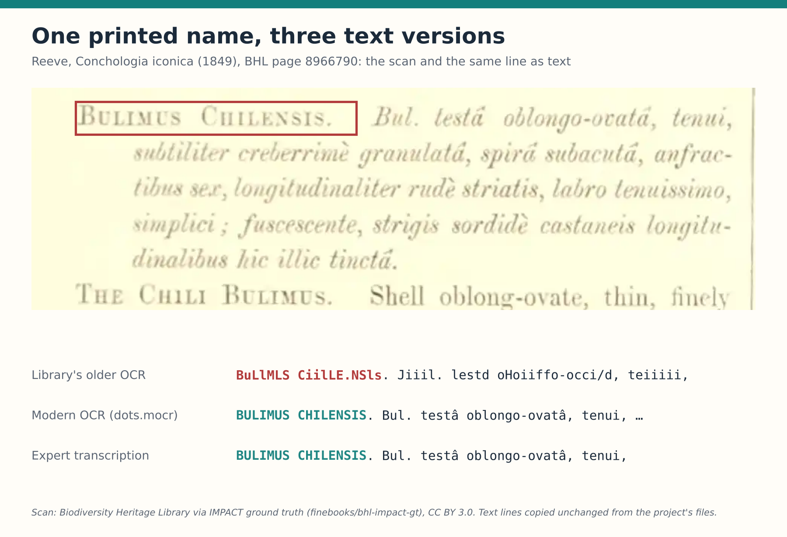</p>

<sub>The real page (BHL page 8966790). The OCR text is copied unchanged from the library's file; modern OCR and the expert transcription both read the name intact. Scan from the Biodiversity Heritage Library via the IMPACT ground-truth set, CC BY 3.0.</sub>

That gap sits inside roughly 64 million scanned pages in the Biodiversity Heritage Library. Historical natural-history books record species names, collection localities, researchers, and dates of observations. OCR and large language models can help turn those pages into structured data for modern databases such as GBIF. Yet pulling text off a page is not the same as producing a record another person can trust: a small error upstream rarely stays small—it compounds down the line. A single misread character can corrupt a species name and break its downstream database match; even a cleanly extracted historical name may fail to resolve against today's taxonomy; and a plausible-looking result may arrive without evidence anyone can verify.

**BioEvidenceBench measures where, between the scanned page and the database record, trustworthy data is lost.** Projects such as [FineBooks](https://huggingface.co/blog/finebooks/historical-books-ocr-leaderboard) ask how accurately AI transcribes historical books; this one asks whether the names, places and dates on a page become data another person can verify, and whether a small, cheap model can be trained to repair the text itself.

## What happens between a page and a usable record?

Turning a scanned book into data is not one model call. Information passes through several stages, and errors can appear at any of them.

<p align="center">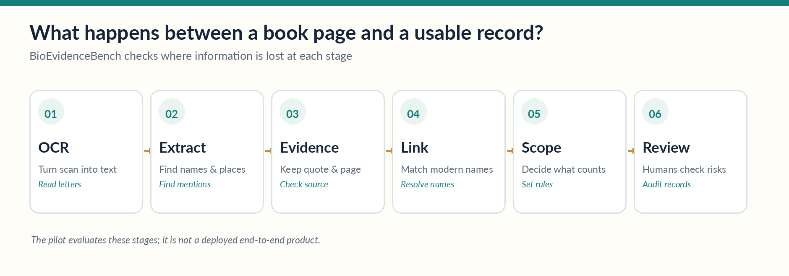</p>

| Stage | In plain language | What could go wrong? |
| --- | --- | --- |
| **1. Read** | OCR turns the scanned page into text. | A letter in a scientific name is misread. |
| **2. Extract** | An AI model identifies names, people, places, institutions, and event dates. | A name is missed, or an unrelated phrase is included. |
| **3. Keep evidence** | Each value is tied to its source line and exact quotation. | The value looks plausible, but cannot be located in the text. |
| **4. Link** | A printed historical name is matched to a present-day taxonomic record. | The name changed, or a database lookup selects the wrong taxon. |
| **5. Define scope** | Written rules say what counts as a record. | An index entry or bibliographic reference is mistaken for an observation. |
| **6. Review** | People inspect uncertain or high-risk outputs. | Agreement between models is mistaken for correctness. |

**One real entry through these stages.** Butler's 1907 account of Sykes' Wagtail: the older OCR garbles the date, extraction and evidence hold, the plain database lookup reaches only the genus, and review settles the record.

<p align="center">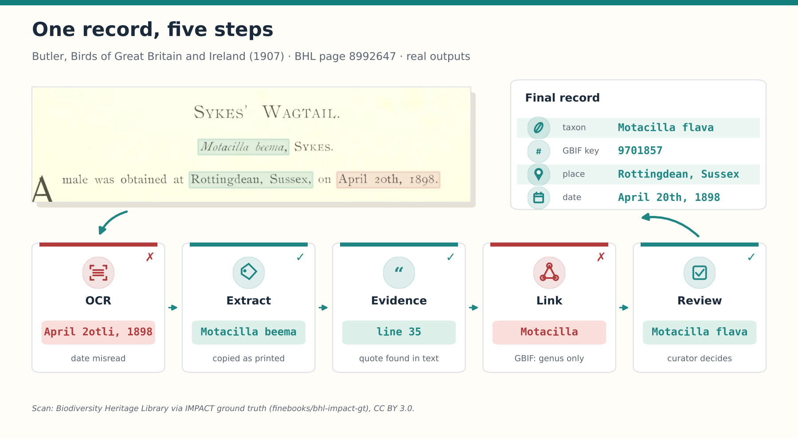</p>

**BioEvidenceBench evaluates reliability across these stages.** Scope rules and human review can apply throughout the workflow; these six dimensions are not necessarily six sequential processing steps. This is a research benchmark and workflow analysis, **not** a deployed digitization or curator-review product.

**Why this matters for AI agents in science.** The same stages apply whether a fixed pipeline or an AI agent does the work. An agent that mines the literature for scientific facts also has to read the page, pick out the facts, cite where each came from, match names to today's databases, and hand uncertain cases to people. Each of those steps can fail quietly, and each can be tested the way this pilot tests them; the findings below say where the checks matter most. BioEvidenceBench evaluates the evidence-handling capabilities a scientific agent can use; it does not claim to be a complete scientific agent.

## The experiment: three versions of the same pages

The pilot uses two English-language works from the [Biodiversity Heritage Library (BHL)](https://www.biodiversitylibrary.org/):

- **Lovell Reeve, *Conchologia iconica*, vol. 5 (1849):** historical descriptions of shells.
- **Arthur G. Butler, *Birds of Great Britain and Ireland*, vol. 2 (1907):** historical bird names and descriptions.

<p align="center">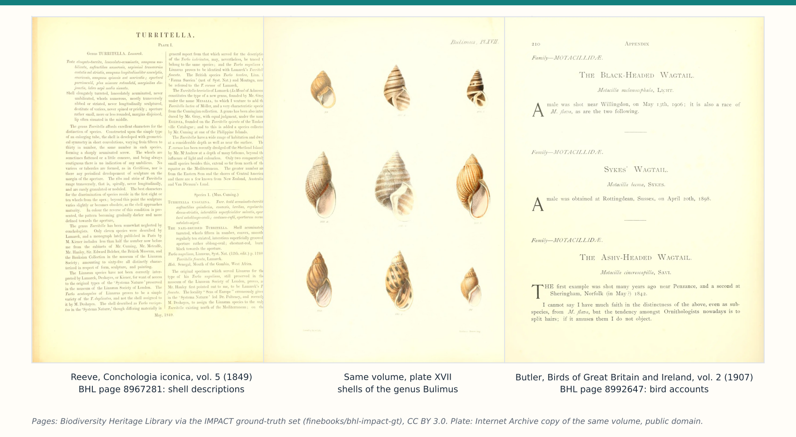</p>

<sub>Real pages from the two books (BHL pages 8967281 and 8992647, via the IMPACT ground-truth set, CC BY 3.0) and plate XVII of the Reeve volume (Internet Archive, public domain).</sub>

Each sampled page was read in three forms, keeping the underlying page constant:

| Version | What it represents |
| --- | --- |
| **Legacy OCR** | The digital library's older machine-readable text. |
| **Modern OCR** | Public output from the open **dots.mocr** model, provided by FineBooks. |
| **Expert transcription** | Expert-corrected text from the IMPACT/BHL corpus, used as the reference. |

A human annotator identified **607 mentions on 22 pages** before viewing the model outputs: **6 development pages** and **16 locked test pages**, the latter containing **421 annotated mentions**. Mentions include taxonomic names, people, localities, institutions, and event dates (with common names scored separately). A second annotator independently labeled five test pages; agreement was **0.90 for exact spans** and **0.95 for overlapping spans** on the primary fields.

The pre-registered research question asked **when better OCR stops being the main bottleneck, and when evidence verification and entity resolution become the limiting factors**. The annotation rules, prompt, scorer, and analysis plan were frozen before the locked-test outputs were opened. [See the pre-registration](PREREGISTRATION.md) and [freeze manifest](FREEZE.json).

### How an answer was checked

The extraction model was instructed to return a **line number and an exact quote**. Code verifies that quote against the input text and extracts the value from that source. This prevents the extraction step from silently rewriting a name, although it does **not** prove that the underlying OCR matches the printed page.

We measured three forms of matching:

- **Lenient match:** did the system identify roughly the right place in the text?
- **Exact match:** did it select the same character span?
- **Value match (primary):** did it recover the correct text value, with only limited formatting normalization?

The primary measure is **value F1**, which combines precision and recall. It is **not** character accuracy or the percentage of pages read correctly. Confidence intervals use **1,000 page-level bootstrap resamples**, calculated separately for the two books.

*Part 1 of 2: evaluating the extraction pipeline (Findings 1–6). Part 2, the training study, follows.*

## Finding 1 — Better OCR changed the downstream result

<p align="center">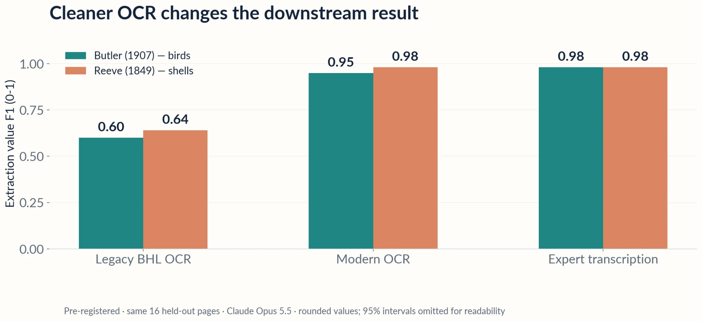</p>

**Pre-registered result · 16 locked test pages · Claude Opus 5.5 · value F1 (higher is better)**

| Same pages, different text | Butler: birds | Reeve: shells |
| --- | ---: | ---: |
| Legacy BHL OCR | **0.60** | **0.64** |
| Modern OCR (dots.mocr) | **0.95** | **0.98** |
| Expert transcription | **0.98** | **0.98** |

<sub>Rounded values; exact scores and 95% intervals are in [Results](docs/results.md). The figure omits intervals for readability; the [original analysis figure](docs/figures/hero.png) includes the intervals.</sub>

With legacy OCR, the model often found a relevant name **at the correct location** but copied its corrupted spelling. Its more forgiving location-based score was **0.93–0.97**, while value F1 was only **0.60–0.64**. Finding the words and recovering the right words were different tasks.

On these pages, improving the source text made a much larger difference than swapping between extraction models in later exploratory comparisons. Once modern OCR was supplied, extraction came within about **0.03 F1** of expert transcription.

**What this means:** before investing in a larger extraction model, measure whether the input text is already losing the values that matter.

## Finding 2 — Few character errors can still mean missing scientific names

An OCR system may have an excellent **character error rate (CER)** and still damage rare Latin names. A small number of mistakes is not necessarily spread evenly across the page.

<p align="center">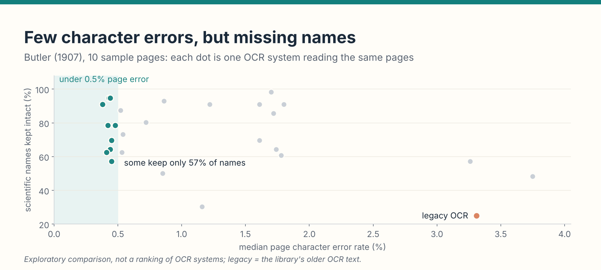</p>

**Exploratory result:** across **24 OCR versions** of the sampled pages (22 FineBooks models, Mistral OCR and the library's legacy OCR), preservation of annotated names tracked downstream extraction much more closely than page-level CER. The Spearman correlations between name preservation and extraction value F1 were **0.95 (Butler)** and **1.00 (Reeve)**; the corresponding correlations with page CER were **−0.11** and **−0.61**. Several OCR models with **under 0.5% page CER** still preserved only **57–79% of Butler's names** intact.

<p align="center">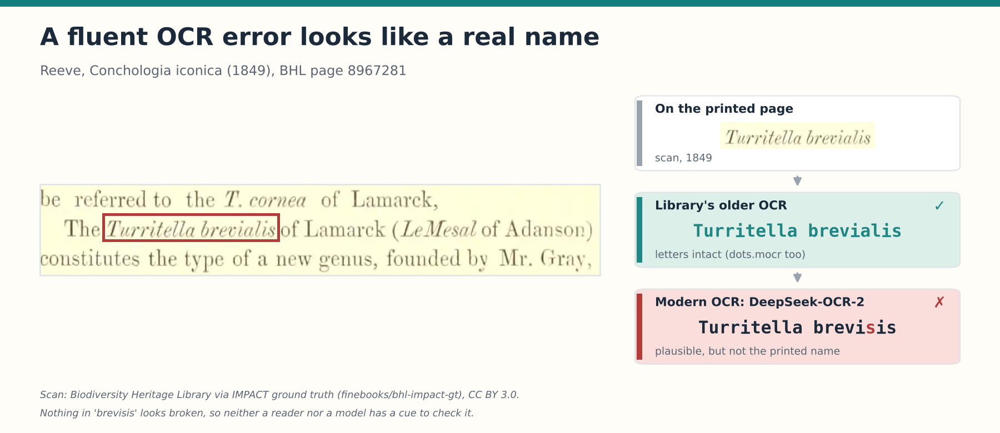</p>

<sub>A real example (Reeve, page 8967281). One modern OCR model wrote a plausible species name that is not on the page. Two wrong letters hardly move the page's character error rate; a check on the names catches it.</sub>

The practical point is about evaluation design: a library interested in biodiversity data should test **whether names survive transcription**, not only how many characters were misread across the whole page.

These are exploratory comparisons on the same small collection, **not** a universal result for all OCR systems or document types.

## Finding 3 — A correctly extracted name can still fail at database linking

A historical book can print a name correctly; the AI can extract it correctly; and a modern database lookup can still return only a genus, a different taxon, or no record. Taxonomy changes over time, so matching text strings is not equivalent to resolving their scientific meaning.

<p align="center">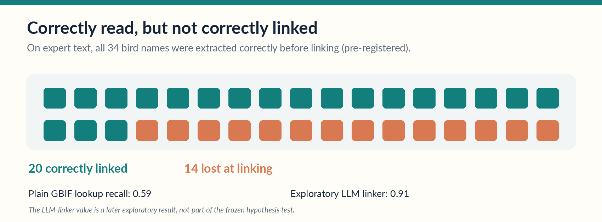</p>

**Pre-registered result:** on expert text, **34 eligible bird-name mentions** were correct before linking. A simple [GBIF](https://www.gbif.org/) name lookup (no surrounding context; an abbreviated genus such as the `M.` in `M. minuta` was first written out from earlier on the page) linked **20** to the correct taxon but failed on **14** — a linking recall of **0.59**. The 14 cases comprised **8 genus-only matches, 3 wrong taxa, and 3 without a record**.

<p align="center">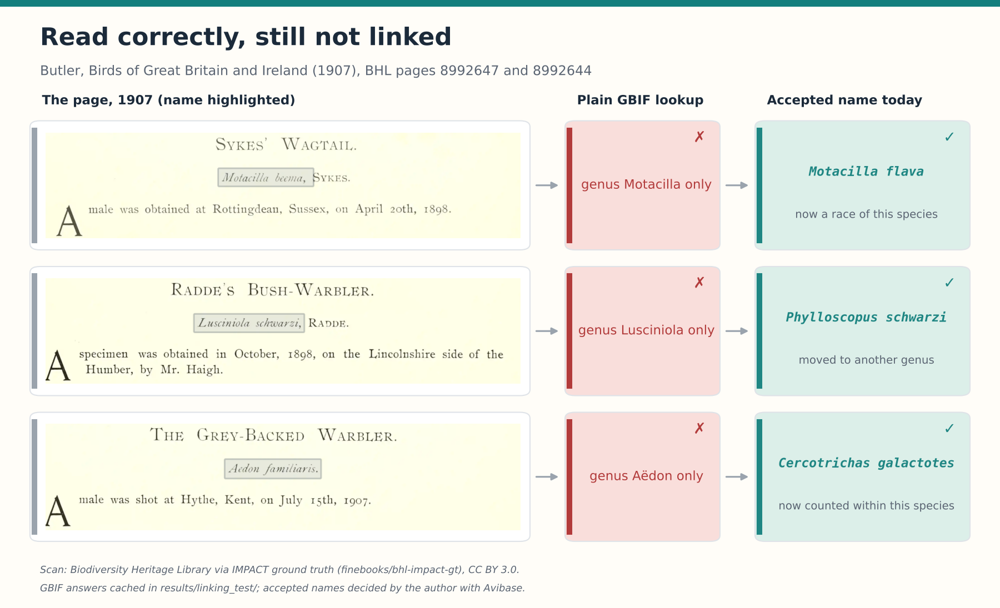</p>

<sub>Three of the 14 failures as printed in 1907. Each name is read correctly; the plain lookup returns only the genus, because the species has since been renamed, moved to another genus or merged into another species.</sub>

A later **exploratory** approach first used an LLM to interpret a historical name in context, then looked up its proposed modern name. It raised linking recall on the same material to **0.91**. This is a useful lead, **not a new independent test result**; unresolved taxonomy still requires a domain expert.

**What this means:** text extraction and scientific entity resolution should be evaluated — and improved — separately.

## Finding 4 — The same accuracy can leave different evidence

An AI result is more useful to a curator when the underlying record can be checked. We compared three ways of working around bad OCR in later exploratory experiments:

| Route | Value F1, Butler / Reeve | Evidence left for review |
| --- | --- | --- |
| **Modern OCR + quote-checked extraction** | **0.95 / 0.98** | Verbatim quote linked to the OCR text and line; the original scan remains the final reference. |
| **LLM repair of legacy OCR** | **0.96 / 0.91** | Repaired readings are flagged; changed values must be checked against the scan. |
| **Read the page image directly** | **0.96 / 0.98** *(value-bag scoring)* | Correct-looking values, but precise image positions may be unreliable. |

In the repair experiment, about **92% of changed values** were correct; the rest illustrate why a repaired word must not be treated as automatically verified. Vision-model boxes located the right word for only **67% of Butler** and **40% of Reeve** values in a separate exploratory check, and overlapped the printed value well (IoU ≥ 0.5) for only **52%** and **23%**.

Requiring a quote in the **pre-registered** extraction comparison did not improve measured accuracy, but **both conditions already extracted source values through code**. That result cannot establish that evidence is unnecessary. Its benefits — traceability and reduced audit effort — need different measures.

## Finding 5 — Two models can agree on the same mistake

One possible way to reduce manual review is to accept a record when **two different models extract the same field at an overlapping position** and the evidence and type checks pass. BioEvidenceBench tested this as a **pre-registered, shadow evaluation**: it measured which predictions *would* have been accepted, without automatically approving any record.

The models agreed on **99–100% of predictions**, leaving at most two unflagged predictions per book and text version — too few to determine whether disagreement would be an effective way to prioritize review. More importantly, the proposed auto-accept sets still contained errors:

| Input text | Errors in proposed auto-accept set: Butler | Reeve |
| --- | ---: | ---: |
| Expert transcription | **3** | **4** |
| Modern OCR | **6** | **5** |
| Legacy OCR | **50** | **75** |

<sub>Pre-registered RQ4 results. These are error counts within the proposed auto-accept sets, **not error rates** or a measure of model agreement; see [Results](docs/results.md).</sub>

The two models often inherited **the same OCR mistake**. Agreement therefore does not provide independent evidence that a name is spelled correctly or that a record is safe to publish. Any automated review shortcut needs to be tested against human-verified records, especially when models share the same input.

## Finding 6 — The definition of a record is part of the evaluation

A model score depends on the rules used to label what is right. Is a date an event date or a citation year? Is a place name one word or an entire descriptive phrase? Should a book's index entries be treated like records?

The project encountered these questions in practice. Even the expert transcription contained typos; the evaluation records the scan's reading separately rather than silently changing the reference. Five boundary conventions in an **exploratory eight-page 1898 California Academy of Sciences botany case** changed the reported F1 from **0.83 to 0.94** for two methods. Because those conventions were resolved after examining outputs, **both before and after scores are reported**.

A separate exploratory whole-book run processed **682 text pages**. Index entries accounted for a substantial share of uncertain outputs; explicitly excluding `Index` pages from the proposed task scope reduced the review queue from **1,404 to 555 mentions**. That is a change in scope, not a claim that the model itself became more accurate.

**What this means:** a benchmark's definitions and review policy are part of the scientific result, not just documentation written afterward.

## Part 2 · Training study — A small model learned part of the repair from examples, not from rewards

If old OCR is where names are lost, could a small, cheap model fix the text itself, one line at a time, before anything is extracted? In a follow-up study we trained an open 0.6-billion-parameter model (Qwen3-0.6B) on five books from the same expert-transcribed collection, then tested it once, on lines it had never seen, under a plan fixed in advance.

<p align="center">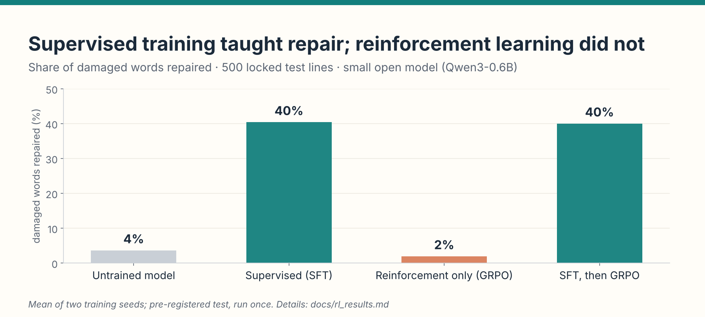</p>

- **Shown expert transcriptions** (supervised fine-tuning), the model learned to repair **40%** of damaged words, up from **4%**, including scientific names, the old long s (ſ) and ligatures such as æ, while changing fewer correct words than before.
- **Trained only on an automatic score** (reinforcement learning with GRPO), it learned to **hand the OCR back unchanged**. Copying never lost points, and its own edits were usually wrong, so doing nothing was the safest way to score.
- **Reinforcement learning after supervised training** did not repair more words; it only made the model slightly more careful with words that were already right.
- **On an unseen French book**, the supervised model kept about half its gain (21% of damaged words repaired).
- **The automatic score had loopholes.** Automated attacks found three; reading answers by hand found two more, for example finishing a word split at the end of a line scored as a perfect answer.

The trained model is [published for research](https://github.com/dekunsun/BioEvidenceBench/releases/tag/rl-sft-ocr-repair-v1), **not** for automatically replacing library text: it still changes about 2 in every 100 correct words. Put in front of the extraction step, it raised value F1 on legacy OCR only from 0.60 to 0.67 (Butler) and 0.64 to 0.72 (Reeve), against about 0.95 with modern OCR, and it turned a few correct names into other names ([details](results/sft_repair_pipeline/REPORT.md)). Full results: [RL technical report](https://dekunsun.github.io/BioEvidenceBench/docs/rl_report/rl_report.html) ([PDF](docs/rl_report/rl_report.pdf)).

**What this means:** for a careful editing task, examples of the right answer did the teaching. A reward that never penalizes doing nothing taught the model to do nothing.

What these findings mean for a library or museum deciding where to put its next unit of money or reviewer time is set out in the [decision memo](docs/product.md).

## External case · *Bencao gangmu* 本草綱目, the Compendium of Materia Medica (exploratory, classical Chinese)

Does the same method work on a different script? A first pilot applies it to six half-leaves of the *Bencao gangmu* (本草綱目, completed 1578), in the Siku quanshu manuscript copy: a pharmacopoeia whose entries name drugs, plants, people, places and the books they quote. The reference text is the Kanseki Repository transcription, checked line by line against the scan by the author, who then labelled 224 mentions (drug or organism, person, place, cited work) before any model extracted from these pages. Claude Opus 5.5 extracted with the same evidence rule as for the English books, from four versions of the text.

| Text given to the extractor | Character error rate | Names intact (variant forms folded) | Value F1 |
| --- | ---: | ---: | ---: |
| Scan-checked reference | 0 | 100% (100%) | 0.98 |
| Claude Opus 5.5 reading the scan | 0.03 | 88% (98%) | 0.87 |
| Claude Haiku 5.5 reading the scan | 0.15 | 69% (87%) | 0.68 |
| PaddleOCR 3.7 (open source) | 0.26 | 68% (81%) | 0.72 |

<sub>Value F1 with 95% intervals from resampling the six half-leaves: reference 0.98 [0.95, 0.99], Opus OCR 0.87 [0.83, 0.91], Haiku 0.68 [0.58, 0.79], PaddleOCR 0.72 [0.60, 0.83]. Haiku and PaddleOCR are not distinguishable on six pages (difference −0.04 [−0.11, 0.03]).</sub>

<p align="center">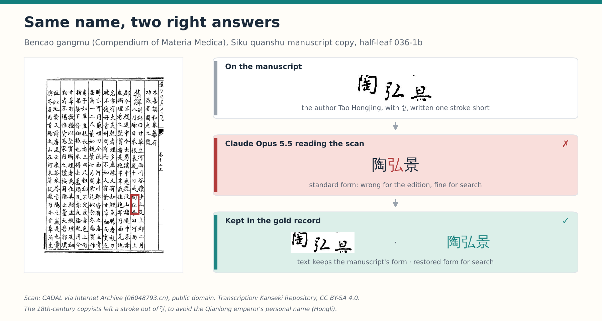</p>

- **The English finding repeats:** whether the names survive OCR tracks extraction; the overall character error rate does not. Haiku makes fewer character errors than PaddleOCR but loses as many names, and does not score higher. They lose names differently: Haiku mostly writes standard forms of characters (30 of its 68 lost names), PaddleOCR mostly misreads them or breaks the reading order of the small two-column notes (58 of 84).
- **A new kind of loss:** the Claude readers often write the standard form of a character where the manuscript has a variant or a taboo form (陶𢎞景 becomes 陶弘景). Counting that as an error or not moves Opus from 88% to 98% of names intact. In the English books the comparable effect, ligatures such as æ, moves the figure by 0 to 2 points. For classical Chinese, an evaluation has to say whether a record must be faithful to the edition or only findable, and score both.
- **Not yet an independent result:** the annotation guide and the extraction prompt were written from these same six half-leaves. An eight-half-leaf test set has been chosen by a fixed rule and the configuration frozen; it waits for the author's labels. Details: [pilot report](results/bencao_pilot/REPORT.md), [annotation guide](docs/notes/bencao_guide.md), [test plan](docs/notes/bencao_prereg.md).

## Why the evaluation can be audited

This is a small pilot, but its methodological choices are intended to make conclusions inspectable:

| Safeguard | Implementation |
| --- | --- |
| **Human reference labels** | 607 hand-labeled mentions; [versioned annotation guide](ANNOTATION_GUIDE.md); a second labeler on five pages. |
| **Held-out test** | 16 pages reserved until the planned experiment was frozen and outputs sealed. |
| **Machine-checkable freeze** | [FREEZE.json](FREEZE.json) hashes the gold, prompt, scorer and analysis; `src/freeze.py --verify` checks it. |
| **Pre-registration vs exploration** | [PREREGISTRATION.md](PREREGISTRATION.md) states planned tests; later changes and investigations appear in [DEVIATIONS.md](DEVIATIONS.md). |
| **Inspectable runs** | Raw model outputs, prompts, run settings, costs and scores are saved under [`results/`](results/) and indexed in [evaluation settings](docs/eval_settings.md). |
| **Uncertainty** | Scores are reported by book with page-bootstrap intervals; uncertain or underpowered comparisons are identified as such. |

Some of the most useful lessons came from unexpected issues: annotation boundaries, typos in expert text, dev-set saturation, and API responses that appeared successful but did not meet the output schema. These are documented in [Lessons learned](docs/lessons_learned.md).

## Scope and limitations

- **Small, specific pilot:** the pre-registered results cover **16 test pages from two English printed books** (1849 and 1907). The books differ in OCR quality, so results are reported separately; confidence intervals are relatively wide.
- **Not all kinds of historical documents:** the pre-registered experiment covers English print only; apart from the classical Chinese pilot below, other languages, eras, tables, illustrated plates, mixed layouts and handwriting were not evaluated.
- **Classical Chinese is a development set only:** six half-leaves of one edition of one work, labelled by the author without domain training (18 expert questions remain open), with the guide and prompt written from the same pages. An eight-page test set is frozen but not yet labelled.
- **Public-data exposure is possible:** the books and transcriptions may have appeared in model training; a follow-up memorization probe found no clear evidence of page memory but cannot rule it out.
- **Labels and scoring require judgment:** most pages had one primary annotator, with a second on five; decisions made after unsealing are identified as exploratory.
- **Traceability is not proof of scientific validity:** verifying a quote against OCR does not independently verify the printed page or settle a historical taxonomic dispute.
- **The training study is narrow:** one small model, one reward design, two training seeds; its locked test measured line repair, and its test inside the extraction pipeline was designed afterwards (exploratory). The released model is a research checkpoint, not a deployed tool.
- **Not peer reviewed / not deployed:** this is an open research pilot. Proposed product features are **not reported as completed experiments**.

## Reproduce the evaluation

The project contains the data loaders, annotation guide, frozen test protocol, scoring code, and model run records. Large page-text collections are fetched again rather than fully redistributed in the repository; selected annotated sample material is included. You can inspect the methodology and reproduce the data preparation without calling a paid LLM API.

```bash
# From the repository root (Python and network access required)
python -m venv .venv
source .venv/bin/activate
pip install -r requirements-lock.txt   # exact versions; requirements.txt has the lower bounds

# Fetch the text versions and calculate OCR statistics
python src/load_gt.py
python src/fetch_legacy_ocr.py
python src/fetch_modern_ocr.py
python src/compute_cer.py
python src/compute_cer.py --version modern_dots-mocr

# Run local tests and check the frozen experiment files
pytest -q
python src/freeze.py --verify
python src/bencao_freeze.py --verify
```

The same three checks run on every push in [GitHub Actions](.github/workflows/ci.yml); the badge at the top shows the latest result.

For **new LLM calls**, see [`src/run_extraction.py`](src/run_extraction.py) and the [evaluation settings](docs/eval_settings.md). API keys, costs, provider settings, output schema, and the sealed/unsealed test procedure matter; do not treat a new run against previously inspected pages as a fresh blind test. Each script under [`src/`](src/) starts with a note on what it does and how to run it; each run folder under [`results/`](results/) keeps its settings, prompts and raw outputs.

## About this project

<p align="center">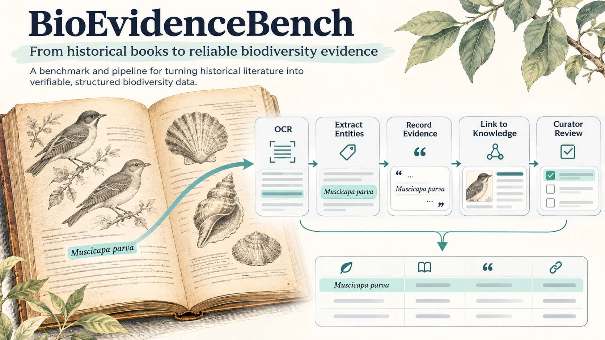</p>

<p align="center"><sub>Concept illustration of the workflow, not a real page or a deployed product.</sub></p>

**What I did:** defined the task and the labeling guide, labeled all 607 reference mentions myself before seeing model output, wrote and froze the pre-registration, ran the error analysis and cost tracking, wrote the decision memo, and trained, tested and released the small model.

## Research materials and data provenance

| Resource | Contents |
| --- | --- |
| **[Preprint](https://dekunsun.github.io/BioEvidenceBench/docs/preprint/preprint.html)** · [PDF](docs/preprint/preprint.pdf) · [Markdown](docs/preprint.md) | Research questions, methods, statistics, limitations and references. |
| **[Results](docs/results.md)** · [Run settings](docs/eval_settings.md) | Full pre-registered and exploratory scores, intervals and provenance. |
| **[Annotation guide](ANNOTATION_GUIDE.md)** · [Gold labels](gold/) | Label definitions, corrections and human reference data. |
| **[Pre-registration](PREREGISTRATION.md)** · [Freeze](FREEZE.json) · [Deviations](DEVIATIONS.md) | What was decided in advance and what changed after testing. |
| **[RL technical report](https://dekunsun.github.io/BioEvidenceBench/docs/rl_report/rl_report.html)** · [PDF](docs/rl_report/rl_report.pdf) · [Markdown](docs/rl_results.md) · [Training report](rl/TRAINING_REPORT.md) · [Released model](https://github.com/dekunsun/BioEvidenceBench/releases/tag/rl-sft-ocr-repair-v1) | Teaching a small model to repair OCR: supervised and reinforcement learning, the reward audit, and the release decision. |
| **[本草綱目 pilot report](results/bencao_pilot/REPORT.md)** · [Guide](docs/notes/bencao_guide.md) · [Test plan](docs/notes/bencao_prereg.md) | The classical Chinese external case: OCR levels, extraction, glyph fidelity, and the frozen test set. |
| **[Lessons learned](docs/lessons_learned.md)** · [Stories](docs/stories/) · [Notes](docs/notes/) | Annotation, data-quality, API, metric and training failures encountered during the study. |
| **[Decision memo and product design](docs/product.md)** · [Poster](poster/preview.png) ([A1 PDF](poster/poster.pdf)) | The decision this pilot informs, six recommendations, a proposed curator workflow; the pilot on one poster. |
| **[FineBooks data](https://huggingface.co/datasets/finebooks/bhl-impact-gt)** · [OCR output](https://huggingface.co/buckets/finebooks/bhl-ocr-outputs) | Expert text and modern OCR underlying the comparisons. |

**Licenses and attribution.** The expert transcriptions are from IMPACT/Biodiversity Heritage Library via FineBooks (**CC BY 3.0**); BHL metadata are **CC0 1.0**; public dots.mocr outputs are published under **MIT** as indicated in the source manifest. This project's code is [MIT-licensed](LICENSE) and its original gold annotations are [CC BY 4.0](gold/LICENSE.md). The 本草綱目 transcription is from the Kanseki Repository (**CC BY-SA 4.0**), and files that contain it carry that licence; the scans are public domain. The illustrated overview figures are explanatory reconstructions; the numerical figures reproduce values reported in this project's run records.

---

**Scanning makes a historical book accessible. OCR makes it searchable. Turning what it says into trustworthy scientific data requires checking the text, the meaning, and the evidence behind every record.**
