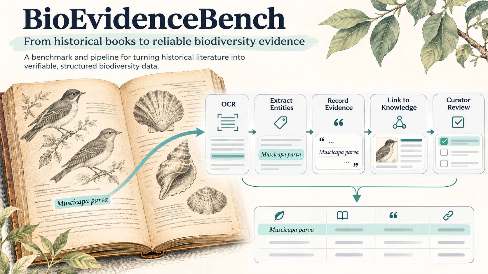
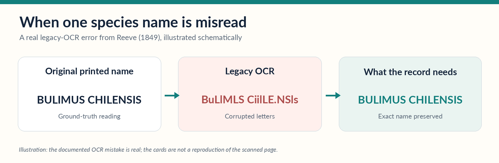
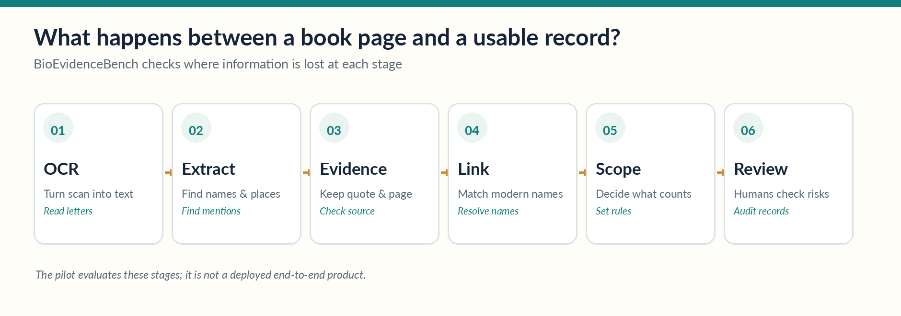
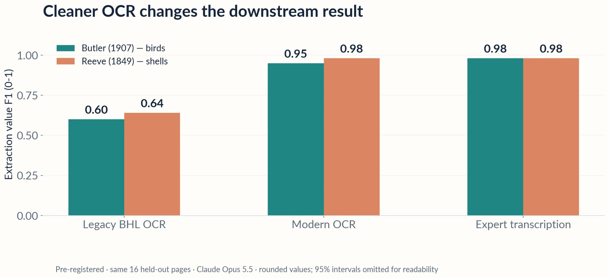
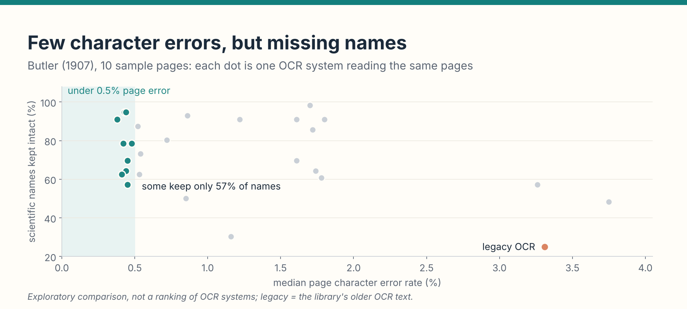
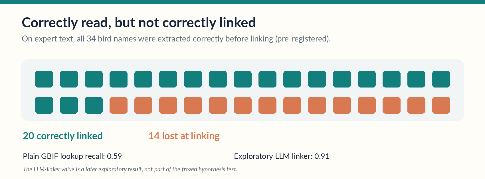
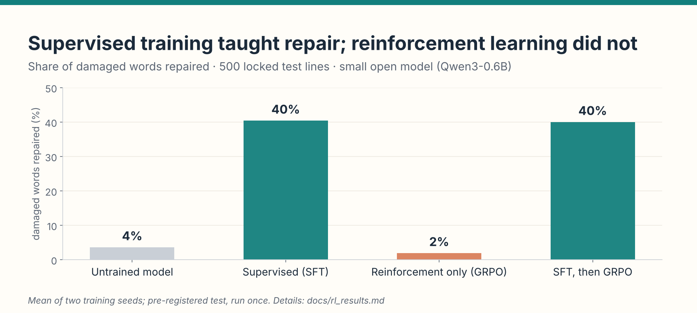

<div align="center">

# BioEvidenceBench

### 从 19 世纪的科学书页到数据库记录，可信的信息在哪一步丢失？

**Dekun Sun** · University of Pennsylvania · [ai4s.fyi](https://ai4s.fyi)

*开放研究试点 · 2026 年 11 月 · 预印本撰写中，尚未经过同行评审*

[**English**](README.md) · [**决策备忘录**](docs/product.md#中文版) · [**研究预印本**](docs/preprint/preprint.pdf) · [**RL 技术报告**](docs/rl_report/rl_report.pdf) · [**完整结果**](docs/results.md) · [**经验教训**](docs/lessons_learned.md) · [**如何复现**](#如何复现实验) · [**Poster**](poster/poster.pdf)



<sub>此图为工作流程概念插画，不是真实历史书页，也不是已经部署的产品。</sub>

</div>

## 一个被读错的学名，会变成错误的科学记录

在 1849 年出版的贝类著作 *Conchologia iconica* 中，书页上印着一个物种学名：**`BULIMUS CHILENSIS`**。数字化时，图书馆早期的 OCR（光学字符识别）系统却把它读成了 **`BuLlMLS CiilLE.NSls`**。

表面上看，数字化已经完成：书已上网，页面也能搜索。把这段文字交给大语言模型，它甚至能准确找出这个学名所在的行。可只要模型忠实复制了上游的错字，最后存进数据库的依然是一个错误名称。



*这个学名和 OCR 误读来自[预印本](docs/preprint.md)中的真实记录；图片为示意图，不是原始扫描页截图。*

同样的隐患藏在生物多样性遗产图书馆（BHL）约 6,400 万页历史文献里。这些历史自然科学著作记录了大量物种名称、采集地点、研究者和观察日期。OCR 和大语言模型能帮我们把书页转成结构化数据，汇入 GBIF 等现代数据库。但把文字从纸面搬到屏幕，不等于产出了一条可信的科学记录——上游的一处小错，往往会在下游不断放大。OCR 读错一个字母，不仅会让学名失真，还会直接导致后续的检索和数据库关联失效；即便上游文字提取完全无误，历史名称也可能因分类学变迁而对不上今天的名录；而一条看似合理的结果，如果缺少可核查的证据，研究者依然无从验证。

**BioEvidenceBench 研究这些错误如何在文献处理过程中产生和传播。** 项目以两本历史自然科学著作为主要测试对象，通过人工标注、预注册评测，以及单独报告的探索性实验，分别检查 OCR、实体提取、证据定位、分类学关联和数据范围定义。研究的目标不只是比较哪个模型更准确，还包括判断可靠性损失发生在哪里，以及哪些改进更值得投入。另一项配套研究追问：能否训练一个便宜的小模型直接修复文字，并检查用来训练它的奖励是否可靠。

[FineBooks](https://huggingface.co/blog/finebooks/historical-books-ocr-leaderboard) 主要研究**模型能否正确转录历史书籍**。BioEvidenceBench 在此基础上进一步追问：

> **当历史文献已经变成文字，AI 能否把里面的学名、人名、地点和日期转成准确、可追溯、能够由其他人核查的科学数据？**

这个问题从生物多样性文献出发，也与医学资料、档案、法律材料等需要从文档中提取可信事实的工作有关。

## 从书页到可用记录，需要经过哪些环节？

一张书页变成科学数据，通常不只是调用一次模型。信息会经过多个环节，每一步都可能出错。



| 环节 | 简单解释 | 可能发生的错误 |
| --- | --- | --- |
| **1. 识别文字** | OCR 将扫描图片转为文字。 | 学名中一个字母被读错。 |
| **2. 提取信息** | AI 找出物种、人物、地点、机构和事件日期。 | 漏掉实体，或多提取了无关内容。 |
| **3. 保存证据** | 给每个值附上原文行号和逐字引语。 | 输出看起来合理，却无法在文字中找到。 |
| **4. 关联实体** | 将历史学名关联到今天的分类学记录。 | 物种改过名称，或数据库查到了错误分类单元。 |
| **5. 定义范围** | 用书面规则规定什么算一条记录。 | 把索引词条或文献引用当作观察记录。 |
| **6. 人工复核** | 研究者或馆员检查不确定、有风险的结果。 | 把两个模型意见一致误当成正确。 |

**BioEvidenceBench 评估这些环节的可靠性。** 其中数据范围定义和人工复核会贯穿多个处理阶段，因此六个维度并不一定是依次执行的六道工序。它是一项研究评测和工作流程分析，**不是**已经上线的数字化或馆员审核产品。

## 实验怎么做：同一页书，用三种文字版本测试

研究选取[生物多样性遗产图书馆（BHL）](https://www.biodiversitylibrary.org/)中的两部英文著作：

- **Lovell Reeve, *Conchologia iconica*, vol. 5（1849）**：历史贝类描述。
- **Arthur G. Butler, *Birds of Great Britain and Ireland*, vol. 2（1907）**：历史鸟类学名和描述。

为了控制变量，同一张书页分别用三种文字输入模型：

| 文字版本 | 含义 |
| --- | --- |
| **旧 OCR** | 数字图书馆早期提供的识别文本。 |
| **现代 OCR** | FineBooks 公开的开源模型 **dots.mocr** 输出。 |
| **专家转录** | IMPACT/BHL 提供的专家校正文稿，作为参考。 |

研究者在看模型答案之前，为 **22 页**人工标注了 **607 处信息**；其中 **6 页用于开发**，另外 **16 页锁定为正式测试集**，含 **421 处标注**。标注类别包括分类学名称、人名、地点、机构、事件日期；俗名另行计分。第二位标注者独立标注了 5 页，主要字段的**严格边界一致率为 0.90**，**有重叠即可的一致率为 0.95**。

预注册的核心研究问题是：**OCR 改善到什么程度后不再是主要瓶颈，证据核对与实体关联又在什么时候成为主要限制？** 实验在打开正式测试输出之前，冻结了标注、提示词、评分代码和分析计划。参见 [PREREGISTRATION.md](PREREGISTRATION.md) 与 [FREEZE.json](FREEZE.json)。

### 怎样判断模型的答案正确？

提取模型需要返回**原文行号和逐字引语**。程序会检查引语是否真的出现在输入文本中，再从原文截取字段值。因此，提取阶段不会悄悄把名称改写成另一个词。不过，这**不能证明 OCR 与原始扫描页完全一致**。

研究用三个层次来评分：

- **宽松匹配（Lenient）：** 是否找到了大致正确的文本位置？
- **严格匹配（Exact）：** 是否选中了完全一致的字符范围？
- **值级匹配（Value）：** 除有限的格式规范化外，是否保留了正确文字？

主要指标是 **Value F1**，综合准确率（Precision）和召回率（Recall）。它**不是 OCR 字符准确率，也不是正确页面所占比例**。95% 置信区间通过每本书分别进行 **1,000 次页面级 Bootstrap 抽样**计算。

*第一部分：提取管线评测（发现一至六）。第二部分是训练研究，在后面。*

## 发现一：改善 OCR 明显提高了下游信息提取质量



**预注册结果 · 16 页锁定测试集 · Claude Opus 5.5 · Value F1（越高越好）**

| 同一批页面，不同文字输入 | Butler：鸟类 | Reeve：贝类 |
| --- | ---: | ---: |
| 旧版 BHL OCR | **0.60** | **0.64** |
| 现代 OCR（dots.mocr） | **0.95** | **0.98** |
| 专家转录 | **0.98** | **0.98** |

*表中为四舍五入后的数据，准确数值与 95% 区间见 [Results](docs/results.md)；插图为便于阅读未绘出区间，可打开[原始分析图](docs/figures/hero.png)查看区间。*

在旧 OCR 条件下，模型经常**找对了位置，却复制了错误的字母**。如果只判断是否找到相应片段，宽松 F1 为 **0.93–0.97**；但要求文字值正确时，Value F1 只有 **0.60–0.64**。找到名字的位置与获得正确的名字，是两件不同的事。

对于这些页面，改善文字输入的收益远大于后续探索中单纯更换提取模型的收益。使用现代 OCR 后，抽取成绩已与专家转录相差约 **0.03 F1**。

**启示：** 在购买更昂贵的提取模型前，先检查重要信息是否已经在 OCR 阶段丢失。

## 发现二：整页字符错误很少，也可能读错关键学名

OCR 常使用 **CER（字符错误率）**衡量总体文字转录效果。但稀有的拉丁学名，即使只错一个字母，也可能影响科学检索和数据库匹配。



**探索性结果：** 在同一批页面的 **24 种 OCR 版本**中（FineBooks 的 22 个模型、Mistral OCR 和图书馆的旧 OCR），学名保留率与下游 Value F1 的相关性明显高于整页 CER。学名保留率与 F1 的 Spearman 相关系数分别为 **0.95（Butler）**和 **1.00（Reeve）**；整页 CER 对应为 **−0.11** 和 **−0.61**。有几种 OCR 模型的整页 CER **低于 0.5%**，但只完整保留了 **57%–79% 的 Butler 学名**。

如果一套数字化系统的目标是支持生物多样性研究，验收 OCR 时就不能只看总字符错误率，还需要直接检查**科学名称有没有逐字保留**。

这是在有限书籍上的探索性观察，不能直接推广到所有历史文献或 OCR 模型。

## 发现三：名字提取得正确，现代数据库仍可能关联错误

书中印着一个正确的历史学名，AI 也将它提取正确，并不保证数据库查询一定找到正确物种。分类学名称会随着时间改变；同名、异名及分类观点差异，都可能影响关联。



**预注册结果：** 在专家转录中，有 **34 处符合条件的鸟类学名提及**在关联前已经正确。简单的 [GBIF](https://www.gbif.org/) 名称查询（不提供上下文，只是先按同页前文把缩写属名补全，如 `M. minuta`），成功将 **20 处**关联到正确分类单元，**14 处**失败，Recall 为 **0.59**。其中 **8 处只匹配到属、3 处匹配错误、3 处找不到记录**。

之后开展的**探索性实验**让 LLM 先依据原文上下文解释历史名称，再用候选现代名称查询数据库，同批材料上的关联 Recall 提升到 **0.91**。但这**不是一次新的独立盲测**，剩余的分类学争议仍需领域专家处理。

**启示：** 文本提取与科学实体关联应当分别建立指标、验证方法和改进计划。

## 发现四：相似的准确率，不代表相同的证据可靠性

对于较差的 OCR，可以用现代模型重读、让 LLM 修复旧文本，或者让多模态模型直接读取扫描图。探索性实验表明，这些方法有时能达到相近的值级准确率，却留下不同的审核证据。

| 路线 | Value F1（Butler / Reeve） | 审核时能看到什么？ |
| --- | --- | --- |
| **现代 OCR + 引语核对** | **0.95 / 0.98** | 输入 OCR 的逐字引语和行号；最终仍可以回到扫描页。 |
| **LLM 修复旧 OCR** | **0.96 / 0.91** | 被修复的文字有标记，但仍需与扫描页核对。 |
| **直接读取扫描图像** | **0.96 / 0.98**（值集合评分） | 可能读对名称，但模型提供的定位框未必可靠。 |

在修复实验中，约 **92% 的被修改值**正确，其余说明“语言流畅的修复”仍可能出错。另一个探索性测试中，视觉模型画出的方框真正覆盖正确词语的比例只有 **67%（Butler）/ 40%（Reeve）**。

预注册实验还发现，要求模型附上原文引语**没有提高已测得的抽取准确率**。这不是说证据无用：因为两种条件都已经由程序从源文本提取字段值，实验无法测量证据对审核时间和可追溯性的全部价值。

## 发现五：两个模型也可能同意同一个错误

减少人工审核的一种设想是：当**两个不同模型在相同或重叠位置提取出同一类别的信息**，而且证据和字段类型检查都通过时，就将该记录列为“拟自动接受”。BioEvidenceBench 在**预注册实验中以影子模式（Shadow Evaluation）测试**了这种规则：只计算哪些记录*本来会*被接受，没有真正跳过人工审核。

两个模型对 **99%–100% 的预测达成一致**，每本书、每种文字版本下最多只有 2 条预测未被一致性规则覆盖，数量不足以可靠判断“模型分歧”是否适合用于审核优先级。但更重要的是，拟自动接受的候选集合中仍存在错误：

| 输入文字 | 拟自动接受集合中的错误数：Butler | Reeve |
| --- | ---: | ---: |
| 专家转录 | **3** | **4** |
| 现代 OCR | **6** | **5** |
| 旧版 OCR | **50** | **75** |

*预注册 RQ4 结果。这里统计的是拟自动接受集合中的**错误条数**，不是错误率，也不是模型一致率。详见[完整结果](docs/results.md)。*

两个模型经常继承**同一处 OCR 误读**，因此达成一致并不能独立证明学名正确，更不能作为无需审核、直接发布科学记录的理由。任何自动放行或审核优先级规则，都需要用人工验证的数据单独检验。

## 发现六：“正确答案”的定义本身会改变评测结果

一个日期应该视为事件日期还是引用年份？地点短语是否包括介词？索引页中的名称算不算需要提取的提及？这些判断都会改变最终分数。

项目实际遇到了此类问题。专家转录本身偶尔也有拼写错误，因此研究单独记录扫描页中的真实写法，而不是默默修改参考文本。在针对 **1898 年 California Academy of Sciences 植物学文献 8 页**的探索性测试中，五项边界约定的裁定，使两种方法报告的 F1 从 **0.83 改为 0.94**。由于这些裁定发生在查看模型输出之后，报告同时保留裁定前后结果，**不把新分数当成独立测试中的模型改进**。

一次独立的**探索性整书实验**处理了 **682 页**有文本的页面。许多待复核记录来自索引页。明确将 BHL `Index` 页排除在当前任务范围之外后，拟议审核队列从 **1,404 处缩小到 555 处**。这是范围定义的改变，而不是模型准确性本身提高了。

**启示：** 数据范围、标注规则和审核策略，也是科学评测的一部分。

## 第二部分 · 训练研究：小模型能从示范里学会一部分修复，但光靠奖励学不会

既然旧 OCR 是学名丢失的主要环节，能不能让一个小而便宜的模型先逐行把文字修好，再做提取？后续研究训练了一个 0.6B 参数的开源模型（Qwen3-0.6B），训练数据来自同一套专家转录中的五本书；测试按事先定好的方案只跑一次，用的都是模型从没见过的行。



- **给它看专家转录**（监督微调，SFT）：受损词修复率从 **4%** 升到 **40%**，包括学名、旧式长 s（ſ）和 æ 这类连字；同时改坏的正确词比训练前更少。
- **只用自动评分训练**（强化学习，GRPO）：它学会了**把 OCR 原样交回**。照抄从不扣分，而它自己的改动大多是错的，所以"什么都不改"最稳。
- **先监督训练、再做强化学习**：没有多修一个词，只是对本来正确的词更谨慎一些。
- **换一本没见过的法语书**：监督训练的模型保留了约一半的提升（修好 21% 的受损词）。
- **自动评分本身有漏洞。** 自动构造的攻击找到 3 个，人工逐条阅读又找到 2 个，例如把行末被断开的单词续写完整，也能拿满分。

训练好的模型已[作为研究用检查点公开](https://github.com/dekunsun/BioEvidenceBench/releases/tag/rl-sft-ocr-repair-v1)，**不能**用于自动替换图书馆的原文：它仍会改坏约 2% 的正确词。把它放在提取之前，旧 OCR 上的提取 F1 只从 0.60 升到 0.67（Butler）、从 0.64 升到 0.72（Reeve），而现代 OCR 约 0.95；它还把几个原本正确的学名改成了别的名字（[详情](results/sft_repair_pipeline/REPORT.md)）。完整结果见 [RL 技术报告](docs/rl_report/rl_report.pdf)（[网页版](docs/rl_results.md)）。

**启示：** 对需要谨慎修改的任务，教会模型的是正确答案的示范；一个从不惩罚"什么都不做"的奖励，教会模型的就是什么都不做。

这些发现对一个要决定下一笔钱或审核人力投在哪里的图书馆或博物馆意味着什么，写在[决策备忘录](docs/product.md#中文版)里。

## 研究结论为什么可以核查？

这是一个小型试点，但项目尽量使每个判断和结果都可追溯：

| 科学性保障 | 实际做法 |
| --- | --- |
| **人工参考答案** | 607 处人工标注；[版本化标注指南](ANNOTATION_GUIDE.md)；第二标注者复核 5 页。 |
| **锁定测试集** | 16 页用于正式测试，分析计划和结果文件在解封前冻结。 |
| **可机器验证的冻结** | [FREEZE.json](FREEZE.json) 保存金标准、提示词、评分与分析文件的哈希；`src/freeze.py --verify` 验证。 |
| **预注册与探索严格区分** | [PREREGISTRATION.md](PREREGISTRATION.md) 保存预先设定的比较；后续改动列在 [DEVIATIONS.md](DEVIATIONS.md)。 |
| **可检查的运行记录** | 原始模型输出、提示词、成本、设置和结果在 [`results/`](results/)；详见 [Evaluation settings](docs/eval_settings.md)。 |
| **统计不确定性** | 每本书分别报告页面 Bootstrap 区间；样本不足的比较明确不下结论。 |

标注边界不清、专家文本错误、开发集过拟合、API 返回不符合 Schema 的结果等问题，都记在 [Lessons learned](docs/lessons_learned.md) 中。

## 研究边界

- **样本有限：** 预注册实验只有两部英文印刷著作中的 **16 页正式测试页面**。两本书的 OCR 质量本身不同，因此分别报告，置信区间也较宽。
- **不能代表所有文献：** 其他语言、书写年代、表格、图版、混合版式和手稿不在主体测试范围。
- **无法完全排除训练数据接触：** 书籍和转录文本公开；后续记忆探针未发现明确证据，但不能证明模型从未见过。
- **金标准也存在判断空间：** 主体由一人标注、五页接受独立复核；解封后的规则调整明确作为探索性结果。
- **证据可追溯不等于科学事实自动正确：** 核对 OCR 引语不能独立证明扫描页中的文字无误，也不能解决历史分类学争议。
- **训练后续研究范围很窄：** 只有一个小模型、一种奖励设计、两个训练种子，锁定测试测的是逐行修复；接进提取流程的测试是之后才设计的（探索性）。公开的模型是研究用检查点，不是已部署的工具。
- **尚未经同行评审、尚未部署：** 这是一项开放研究试点。产品设想不作为已完成的实验报告。

## 如何复现实验

仓库公开了数据读取、标注指南、冻结实验协议、评分代码以及模型运行记录。大规模源页面文字由脚本重新获取，而不是全部放进仓库；少量用于标注的样本文字包含在项目中。**无需调用付费模型 API，也能检查方法并复现部分数据准备过程。**

```bash
# 在仓库根目录执行（需要 Python 和网络连接）
python -m venv .venv
source .venv/bin/activate
pip install -r requirements.txt

# 获取文字版本，计算 OCR 统计
python src/load_gt.py
python src/fetch_legacy_ocr.py
python src/fetch_modern_ocr.py
python src/compute_cer.py
python src/compute_cer.py --version modern_dots-mocr

# 运行单元测试，核对冻结文件
pytest -q
python src/freeze.py --verify
```

如需**重新调用 LLM**，请查看 [`src/run_extraction.py`](src/run_extraction.py) 和 [Evaluation settings](docs/eval_settings.md)。API 密钥、费用、模型调用方式、输出格式和测试集封存流程均影响结果。对已经查看过的页面重新运行，**不能称作新的盲测**。

## 关于这个项目

**我做了什么：** 定义任务、写标注规范；在看到任何模型输出之前亲手标注全部 607 个参考提及；写好预注册并在测试前冻结；做错误分析和成本记录；写决策备忘录；训练、测试并公开发布小模型。

**接着读：** [决策备忘录](docs/product.md#中文版) · [研究预印本](docs/preprint/preprint.pdf) · [RL 技术报告](docs/rl_report/rl_report.pdf) · [经验教训](docs/lessons_learned.md)

## 研究资料与数据来源

| 资料 | 内容 |
| --- | --- |
| **[预印本 PDF](docs/preprint/preprint.pdf)** · [HTML](docs/preprint/preprint.html) · [Markdown](docs/preprint.md) | 研究问题、方法、统计、局限和参考文献。 |
| **[完整结果](docs/results.md)** · [运行设置](docs/eval_settings.md) | 所有预注册与探索性结果、区间和来源。 |
| **[标注指南](ANNOTATION_GUIDE.md)** · [金标准](gold/) | 标注边界、修正记录与人工参考数据。 |
| **[预注册](PREREGISTRATION.md)** · [冻结文件](FREEZE.json) · [变更](DEVIATIONS.md) | 测试前决定了什么、测试后又做了什么。 |
| **[RL 技术报告](docs/rl_report/rl_report.pdf)** · [网页版](docs/rl_results.md) · [训练报告](rl/TRAINING_REPORT.md) · [公开的模型](https://github.com/dekunsun/BioEvidenceBench/releases/tag/rl-sft-ocr-repair-v1) | 教小模型修复 OCR：监督训练与强化学习、奖励审计和发布决定。 |
| **[经验记录](docs/lessons_learned.md)** · [故事](docs/stories/) · [笔记](docs/notes/) | 标注、数据质量、API、评测指标和训练中遇到的问题。 |
| **[产品设计](docs/product.md)** · [海报](poster/poster.pdf) | 产品化启示与试点研究介绍。 |
| **[FineBooks 数据集](https://huggingface.co/datasets/finebooks/bhl-impact-gt)** · [OCR 输出](https://huggingface.co/buckets/finebooks/bhl-ocr-outputs) | 专家转录和现代 OCR 的上游来源。 |

**许可与署名。** 专家转录来自 FineBooks 提供的 IMPACT/Biodiversity Heritage Library 数据（**CC BY 3.0**）；BHL 元数据为 **CC0 1.0**；公开 dots.mocr 输出的来源清单标明 **MIT**。本项目代码为 [MIT](LICENSE)，原创人工标注为 [CC BY 4.0](gold/LICENSE.md)。图文介绍中的插画属于解释性示意图；数字来自本项目的实验记录。

---

**扫描使历史书籍可以被看到，OCR 使它们能够被搜索。要让书中的文字成为可信的科学数据，还需要核对每个名称的写法、含义与证据。**
