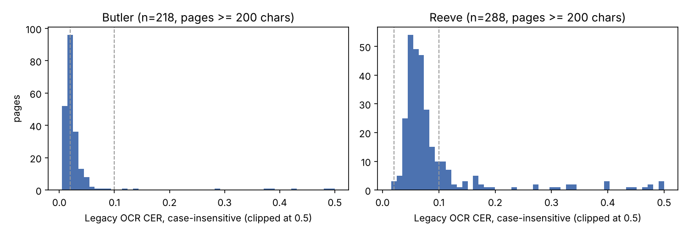

# 02 Legacy OCR CER against the expert transcription

Generated by `src/compute_cer.py --version legacy`. CER = edit distance / expert characters, after light
normalisation (NFKC, ASCII quotes and dashes, whitespace collapsed). `cer_raw` skips all but
the whitespace step. Tables and bands use `cer_nocase` (case-insensitive), because the experts typed
small capitals as upper case and the OCR did not; that is a convention, not a misread.
Bands: low < 2%, medium 2-10%, high >= 10% (fixed before looking at data).

## All text pages

| book   |   count |   mean |   10% |   25% |   50% |   75% |   90% |   max |   low |   medium |   high |
|:-------|--------:|-------:|------:|------:|------:|------:|------:|------:|------:|---------:|-------:|
| Butler |     274 |  0.185 | 0.012 | 0.016 | 0.022 | 0.049 | 0.823 | 1.518 |   117 |       95 |     62 |
| Reeve  |     441 |  0.343 | 0.047 | 0.058 | 0.088 | 0.78  | 0.887 | 1.256 |     2 |      233 |    206 |

## Pages with at least 200 expert characters

Short pages (a page number, a one-line plate caption) make CER jumpy, so this is the fairer view.

| book   |   count |   mean |   10% |   25% |   50% |   75% |   90% |   max |   low |   medium |   high |
|:-------|--------:|-------:|------:|------:|------:|------:|------:|------:|------:|---------:|-------:|
| Butler |     218 |  0.034 | 0.012 | 0.015 | 0.02  | 0.027 | 0.042 | 0.525 |   117 |       93 |      8 |
| Reeve  |     288 |  0.093 | 0.044 | 0.051 | 0.066 | 0.087 | 0.151 | 0.723 |     2 |      231 |     55 |

## Things to know before reading these numbers

- **Re-ordering, not misreading.** 4 pages have CER > 10% but miss < 5% of the expert words. Their characters are mostly right but in a different order (captions, columns, footnotes, missing `<ReadingOrder>`). Their CER overstates how badly the OCR misread the page. The `word_miss` column in `data/cer_legacy.csv` lets you spot them.
- Mean `cer` (case-sensitive) minus mean `cer_nocase`: 0.028. This is how much error comes only from small capitals.
- Mean `cer_raw` minus mean `cer`: 0.005. This is how much of the raw error comes only from ligatures, long-s, quotes and dashes.
- Pages with U+FFFD (illegible) in the expert text: 105. Each U+FFFD counts as one error.
- The sample is two books. These distributions describe these two books only.
