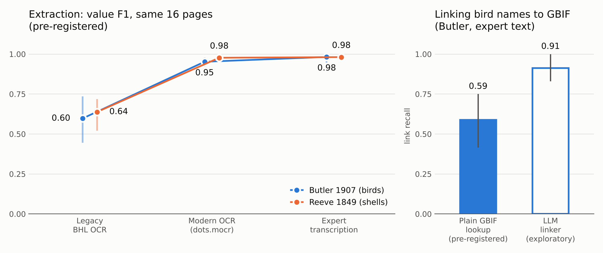
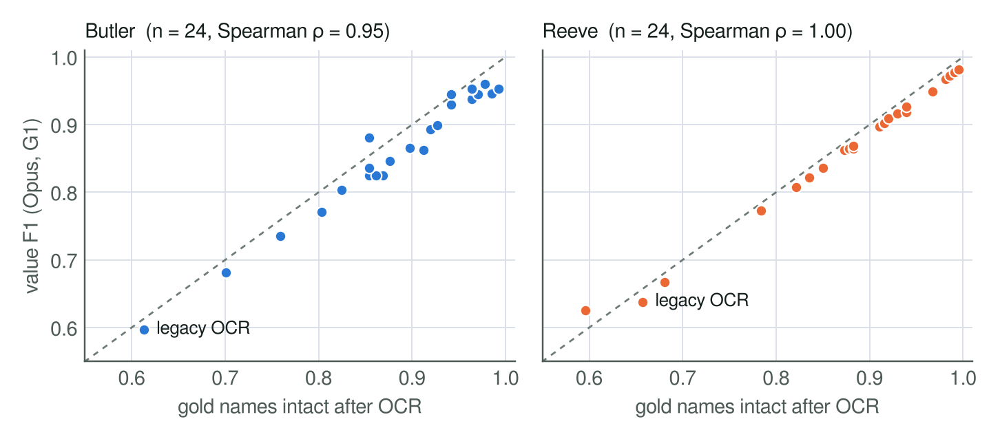

# Where is trustworthy data lost between a historical page and a database? A pre-registered, stage-by-stage evaluation of evidence-grounded extraction from biodiversity literature

**Dekun Sun** · University of Pennsylvania

*Preprint, work in progress, November 2026. Not peer reviewed. Code, data and every run record:
[github.com/dekunsun/BioEvidenceBench](https://github.com/dekunsun/BioEvidenceBench). Results marked
**[pre-registered]** come from a run frozen before the test pages were processed; results marked
**[exploratory]** were designed after the test outputs were unsealed and are logged as deviations.*

---

## Abstract

Large language models (LLMs) make it easy to pull species names, places, people and dates out of
scanned historical literature. Making those records *trustworthy*, that is, correct and traceable to the
printed page, is harder, and it is not obvious where the next unit of effort should go: better optical
character recognition (OCR), a better model, automated verification, entity resolution or human review.
We follow one mention through six steps (page to text, text to mention, mention to evidence, mention to
entity, the definition of what counts as a datum, and review) and measure how much reliability each step
loses. We use two English books from the Biodiversity Heritage Library (BHL), Butler 1907 (birds) and
Reeve 1849 (shells), whose pages exist in three versions: BHL's legacy OCR, a modern open OCR and an
expert transcription. 607 mentions on 22 pages were labelled by hand before any model output was seen;
the plan, gold set and code were frozen before the 16 test pages were processed. The extraction model
returns a line number and a verbatim quote; code checks the quote and slices the value, so the model
never rewrites the source. **[pre-registered]** On legacy OCR, value-level F1 was 0.60 (Butler) and
0.64 (Reeve); on modern OCR 0.95 and 0.98; on the expert transcription 0.98 for both. A plain GBIF name
lookup then lost 14 of 34 correctly extracted bird names, against 0 lost before linking. Requiring a
verbatim quote cost no accuracy, and agreement between two LLMs from different providers did not imply
correctness. **[exploratory]** Across 24 OCR versions of the same pages, the share of gold names that
survived OCR intact predicted extraction almost exactly (Spearman 0.95 and 1.00), while page character
error rate did not (−0.11 and −0.61). Four Claude models differed by at most 0.05 in extraction F1 but by
0.15 in linking recall. Three routes past bad OCR (modern OCR, LLM repair of legacy OCR, reading the page
image) reached similar F1 but left very different evidence for an auditor. On these books, OCR was the
first bottleneck and modern OCR removed most of it; after that, trust was limited by entity resolution and
by the definition of what counts as a datum, not by the extraction model. We do not claim this for other
languages, layouts, print eras, tables or handwriting. **[separate study]** In a pre-registered training
study on the same expert-transcribed collection, supervised fine-tuning taught a small open model
(Qwen3-0.6B) to repair 40% of damaged words in legacy OCR lines (4% untrained); reinforcement learning with
a verifiable reward (GRPO) taught it to copy the OCR, and added nothing after supervised training.

---

## 1. Introduction

The Biodiversity Heritage Library holds about 64 million scanned pages of biodiversity literature. Its
text layer is largely uncorrected OCR from old print. Several groups are now turning this layer into data:
FineBooks re-OCRs BHL with open models and publishes an OCR leaderboard; the Natural History Museum,
London (NHM) is building a BHL discovery layer and a knowledge graph on top of re-OCRed text [1–3]; Plazi
has long extracted treatments with journal-specific templates [4].

Most evaluations in this space report a single number per stage: a page-level OCR accuracy, or an
end-to-end entity F1. A data curator who must decide where to spend the next unit of money needs
something different: **how much reliability is lost at each step between the printed page and the
database record, and what it costs to win it back.** This paper asks that question on a small, controlled
pilot. It is a system-level evaluation of evidence-grounded extraction, not an OCR benchmark.

The research question, written before any data were seen:

> When does improved OCR stop being the main bottleneck, and when do evidence verification and entity
> resolution become the limiting factors for trustworthy scientific data extraction?

"When" is treated as something to measure; "there is no single threshold" is a valid answer.

**Contributions.**

1. A stage-by-stage evaluation design that holds each page constant and varies only the text it is read
   from (legacy OCR, modern OCR, expert transcription), with gold labels made before any model output and
   a pre-registered, frozen analysis.
2. A measurement of where reliability is lost on two historical books, including the step most pipelines
   do not score: linking extracted names to a taxonomic backbone.
3. Evidence that **name preservation**, not page error rate, is the OCR metric that predicts downstream
   extraction, and a proposal to use it as an acceptance test for re-OCR projects.
4. A comparison showing that **routes with equal accuracy can leave unequal evidence**, and that a null
   result on an evidence requirement says more about the accuracy metric than about evidence.
5. Open materials: guide, gold set, prompts, raw outputs, scorer, run settings and a decision memo.

---

## 2. Related work

**OCR for BHL.** FineBooks (Hugging Face and EleutherAI) published expert transcriptions for six BHL
works from the IMPACT project, a Parquet copy of BHL metadata, per-page outputs of many open OCR models,
and a leaderboard scored by character error rate [1]. R. Page has benchmarked further OCR and
vision-language models with the same harness, including several Mistral OCR versions, and reports a
regression in a newer version [5]. This paper takes OCR quality as given and studies what happens
downstream.

**NHM's BHL and knowledge-graph work.** NHM has built botanical knowledge graphs with relational graph
convolutional networks [6], a Planetary Knowledge Base (PKB) prototype with more than 100 million nodes
used to align specimen-label text to graph entities [7], and ADEPT, a pipeline that extracts plant
functional traits from BHL and online floras, released as a dataset of 888,328 trait values for 59,369
angiosperm species [8, 9]. A 2026 BHL prototype processed about 35,000 pages from two journals, reporting
OCR accuracy of 99.57% and taxon extraction F1 of 96.15% [2]; later talks describe re-OCR of the whole
corpus with Mistral OCR, linking to GBIF, Catalogue of Life, Wikidata and GRSciColl with provenance and
confidence, and an open gold set planned for early 2027 [3]. ADEPT's public evaluation bundle reports
micro F1 0.867 on 50 development descriptions and states that it is not a held-out test [9]. These
results are not comparable with ours (different samples, entity definitions and matching rules), and we
make no claim to reproduce them. Our contribution is complementary: we measure the step-by-step losses
that single end-to-end numbers do not show.

**Evaluation method.** We borrow the evaluation design of Lei, Docherty and Cooper [10], who labelled
micrographs in materials science papers before seeing model output and compared LLMs with keyword
baselines. Their study did not involve OCR and asked a different question; this work is not an extension
of their experiment.

---

## 3. Task and data

### 3.1 Books and text versions

The two English works in FineBooks' expert-transcribed set: Butler, *Birds of Great Britain and Ireland*,
vol. 2 (1907; 341 pages), and Reeve, *Conchologia iconica*, vol. 5 (1849; 648 pages). Every page exists in
four text versions:

| Version | Source | Note |
| --- | --- | --- |
| `legacy` | BHL's own OCR, per page, from BHL's open data | What BHL serves today |
| `modern_dots-mocr` | FineBooks' public output of dots.mocr | Lowest CER on the FineBooks board; Markdown, no coordinates |
| `modern_dots-mocr_plain` | The same text with Markdown marks deleted | Formatting ablation |
| `expert` | IMPACT expert transcription (CC-BY 3.0) | Gold offsets refer to this text |

Median page character error rate (CER) of the legacy OCR, case-insensitive, on pages with at least 200
characters, was 6.6% for Reeve and 2.0% for Butler; dots.mocr brought it to 1.3% and 1.1%. Reeve's legacy
OCR fails exactly on the fields of interest (italic Latin diagnoses, abbreviations): `BULIMUS CHILENSIS`
reads `BuLlMLS CiilLE.NSls`. Book and OCR quality are therefore confounded, and every result is reported
per book.

### 3.2 Sample

22 pages were sampled by stratum (entity-rich, low-density, no target names, poor OCR) across the range
of legacy CER, using TaxonFinder name counts from BHL metadata to find candidates: 6 development pages
(3 per book) and 16 locked test pages (Butler 7, Reeve 9). Strata were defined before the labelling guide;
one page sampled as "no entities" turned out to hold two mentions under the guide.

### 3.3 Gold labels

The annotation unit is a **mention**: a character span in the expert transcription plus one field:
`taxon`, `person`, `locality`, `institution`, `date` (event dates only) and `vernacular` (scored
separately, never in the primary number). The field set follows the entity types of NHM's BHL prototype,
plus dates. The guide went through ten versions (v0.1–v0.10), each with a changelog. The labeller
labelled every page before seeing any model output on it; each delivery was archived unchanged before any
comparison; every later change was decided by the labeller and logged. Rules found on test pages went into
the guide and the gold but never into the prompt, which was fixed at guide v0.6; scores are also reported
with those rows treated as optional. Known typos in the expert transcription (`nontifringilla` for the
scan's `montifringilla`) are recorded with the scan's reading as an accepted alternative.

Gold size: development 186 mentions, test 421 (primary fields: Butler 137, Reeve 213). A second labeller
labelled 5 test pages with a copy of the guide whose examples did not come from those pages. Agreement on
the primary fields was 0.90 (exact span) and 0.95 (overlap); locality was lowest (0.75 exact), almost all
at span edges. All 23 disagreements were adjudicated by the first labeller; none changed the gold.

### 3.4 External and scale-up material

- **PCAS botany case** [exploratory]: 8 pages of Eastwood 1898 (Proceedings of the California Academy of
  Sciences, 3rd series, Botany 1), labelled against the scans (210 mentions), with no expert transcription.
  Reported separately and never pooled.
- **Whole-book run** [exploratory]: all 682 pages of both books with at least 20 characters of dots.mocr
  text, with a 60-item spot-check against the scans.

---

## 4. Methods

### 4.1 Extraction without rewriting

The model never rewrites the source. Lines are numbered; in condition **G0** the model returns field and
value and code aligns the value to the source afterwards; in **G1** the model returns field, line number
and a verbatim quote, and code checks the quote character by character in that line and slices the value
from the source. A quote that does not match is logged as a silent correction; a quote not found is
invalid evidence. Because values are sliced, "hallucination rate" is zero by construction and is not
reported; we report unsupported outputs, wrong lines and type-check failures instead.

Pre-registered models: Claude Opus 5.5 (Message Batches API, adaptive thinking, effort medium) and Gemini
4 Carbon (synchronous API with the JSON schema enforced; Google's batch interface did not enforce the
schema in a development run). Temperature was never set. One prompt (`p4-guide-v0.6`) for every text
version. A rule baseline used gnfinder v1.4.0 for names and regular expressions for places and dates.

### 4.2 Scoring

One-to-one matching per page and field at three levels: **lenient** (character overlap), **exact** (same
span) and **value** (overlap and the same text after normalising case, whitespace, end punctuation,
line-end hyphenation and typographic quote and hyphen forms; letters are never changed). Value level is
primary, because a well-placed misread name is wrong data. Predictions on OCR text are mapped to expert
offsets by character alignment. 95% intervals come from 1,000 page-bootstrap resamples per book, paired
for differences; verdicts compare intervals with thresholds written in advance. There is no correction for
multiple comparisons: this is a pilot, and every comparison is reported.

### 4.3 Entity resolution

For Butler's 29 distinct printed names (43 taxon mentions), the labeller recorded the currently accepted
name, using Avibase first, with a status of resolved, partial, ambiguous or unresolved; a script turned
names into GBIF backbone keys by exact, rank-checked match. The pre-registered linker is a plain GBIF
`species/match` lookup with no hints. Subfamily names are not scored because the backbone has no such
rank. The pre-registered hypothesis was that more gold-resolved names are lost at linking than before it.

### 4.4 Review prioritisation (shadow evaluation)

A prediction is flagged "proposed auto-accept" if the other model extracted an overlapping span of the
same field and the evidence and type checks pass. Nothing skips review; flags are scored against the gold
set to see how many errors would have passed. Verdicts need at least 10 unflagged predictions.

### 4.5 Freeze and sealing

Test-page outputs were written to a sealed archive on arrival. Before unsealing, the gold set, guide,
prompt, scorer, analysis code and run settings were hashed into `FREEZE.json`; the unseal script refuses
to run unless every hash matches. The pre-registration itself is frozen, so every later change is logged
in a separate deviations file.

---

## 5. Pre-registered results

*Figure 1. Left: value F1 of Claude Opus 5.5 (G1) on the same 16 test pages read as legacy OCR, modern OCR
and expert transcription, with 95% page-bootstrap intervals. Right: Butler link recall on the expert text
for the pre-registered plain GBIF lookup and, for reference, the exploratory LLM linker (§6.2).*

### 5.1 RQ1: OCR quality

| Value F1, primary fields, G1 | Butler (137 gold) | Reeve (213 gold) |
| --- | --- | --- |
| Opus, legacy OCR | 0.597 [0.445, 0.736] | 0.638 [0.521, 0.719] |
| Opus, modern OCR | 0.952 [0.923, 0.979] | 0.977 [0.954, 0.997] |
| Opus, expert transcription | 0.982 [0.947, 1.000] | 0.981 [0.974, 1.000] |
| Gemini, legacy / modern / expert | 0.604 / 0.964 / 0.975 | 0.642 / 0.979 / 0.988 |

For Reeve, legacy → modern gained +0.34 [0.25, 0.46] (verdict: supports, threshold 0.10) and modern →
expert +0.005 [−0.015, 0.03] (supports, below 0.05). Butler is descriptive: +0.36 and +0.03 [0.01, 0.06].
On legacy OCR the models found the right place (lenient F1 0.93–0.97) but copied the misread text.
Removing Markdown changed F1 by −0.015 to 0. The labeller tagged each of the 163 gold mentions that Opus
got wrong in some text version (several tags allowed): 151 were OCR-sensitive (130 only that), 17
extraction or reasoning errors, 32 ambiguous or mixed.

### 5.2 RQ2: LLM against a rule baseline

On the expert text, the LLM's recall was higher for taxon and person in both books and for Butler's
localities (supports); Reeve's localities and institutions and Butler's dates were inconclusive. Taxon
value F1 was 1.00 against 0.64 (Butler) and 0.99 against 0.54 (Reeve). The largest gap was for person
(recall +0.74 and +0.78), not for institution as predicted.

### 5.3 RQ3: requiring evidence

Requiring a verbatim quote changed recall by −0.015 to +0.007 (no cost; supports). Neither condition
produced an unsupported output in either book or text version (0 of 174–232 outputs per cell), and there
were no wrong lines or silent corrections. The expected reduction could therefore not be observed (§7.3).

### 5.4 RQ4: agreement as a review signal

The two models agreed on 99–100% of predictions, leaving at most 2 unflagged per book and text version:
too few to compare. Errors inside the "proposed auto-accept" set were 3 (Butler) and 4 (Reeve) on the
expert text, 6 and 5 on modern OCR, and **50 and 75 on legacy OCR**. Both models copied the same OCR
damage.

### 5.5 E4: where names are lost

On the expert text, of 34 gold-resolved Butler names, **14 were lost at linking and 0 before it**
(difference 0.41 [0.25, 0.60]; supports); on modern OCR, 13 against 1 (0.35 [0.10, 0.55]). Plain-lookup
link recall was 0.59 even on the expert text (8 matched only at genus, 3 to the wrong taxon, 3 not found)
and 0.12 on legacy OCR. The lost names are old genera and synonyms (`Aedon`, `Lusciniola`, `Munia`),
names now treated as races of another species (`Motacilla beema`), abbreviated genera whose full name is
not on the page (`M. minuta`) and a homonym (`Passer`).

### 5.6 Sensitivity

Treating the 12 gold rows decided by guide rules added after the prompt as optional changed primary F1 by
at most 0.004.

---

## 6. Exploratory results

Everything in this section was designed after the test outputs were unsealed, uses the same 16 test pages,
frozen gold and scorer, and needs a fresh test set before it counts as a finding.

### 6.1 Name preservation, not page error rate

The 22 FineBooks OCR rows whose outputs may be sent to an API, Mistral OCR (through OpenRouter) and legacy
OCR (24 versions per book) were run through the frozen G1 condition. Value F1 tracked the share of gold names that survived OCR intact (Spearman 0.95 Butler, 1.00
Reeve) and not page CER (−0.11, −0.61). Several OCR models with page CER under 0.5% kept only 57–79% of
Butler's names intact. Extraction recall was close to preservation (median gap +0.01): if the name
survives OCR, the model gets it.

*Figure 2. Each point is one OCR version of the same 16 test pages (24 versions per book: 22 FineBooks rows,
Mistral OCR and legacy OCR). The dashed line is y = x.*

### 6.2 Is the linking loss the linker's?

Mostly. A GBIF lookup with an animal hint and abbreviation expansion reached 0.62. An LLM linker (printed
name and its context → currently accepted name → GBIF) reached 0.91 on the expert text and 0.71 on legacy
OCR (from 0.12). Its remaining misses are taxonomic judgments (`Phylloscopus tristis` as a race of
*P. collybita*). The model mattered here: Opus 0.91, Fable 5.2 0.88, Sonnet 5.5 0.79, Haiku 5.5 0.76.

### 6.3 LLM repair and reading the image

- **G2, repair**: the model keeps a verbatim quote (checked as in G1) and adds a separate repaired reading,
  scored on the reading and flagged when it differs. Legacy OCR rose from 0.60 to 0.96 (Butler) and 0.64 to
  0.91 (Reeve); Tesseract output from 0.68 and 0.67 to 0.96 and 0.94. About 30% of legacy values were changed, 92%
  of them correctly. On the expert text G2 changed four values, three of them the transcription's own
  typos.
- **Fluent OCR errors are not repairable**: DeepSeek-OCR-2 writes plausible text (`Linnaeus` for
  `Linnæus`, `Turritella brevisis`); repair reached only 0.81 and 0.87.
- **V1, page image only**: 0.96 and 0.98 (value-bag scoring). **V2**, image plus OCR, added nothing over
  repair.

### 6.4 Other exploratory checks

Each row is a short check on the same 16 test pages unless stated; details and run folders are in
[Results](results.md).

| Question | Result |
| --- | --- |
| Does a cheaper or stronger extraction model change the picture? | Value F1 (G1, Butler / Reeve) on modern OCR: Haiku 5.5 0.94 / 0.95, Sonnet 5.5 0.93 / 0.97, Opus 5.5 0.95 / 0.98, Fable 5.2 0.96 / 0.98; on legacy OCR all 0.58–0.65. Cost per 1,000 page-passes: Haiku US$0.6 (batch), Sonnet 10 (sync), Opus 11 (batch), Fable 43 (sync). The model gap (≤ 0.05) is small next to the OCR gap (about 0.35). |
| Is repair driven by a remembered page? | No sign of it. In the expert text, 69 gold names got a visible typo (two letters swapped) and 29 binomials got a fluent epithet swap from elsewhere in the same book. Opus and Fable restored 65–68 of the typos, Haiku 54; none of the three restored any of the 29 fluent swaps. This does not rule out memorisation in general. |
| Can a vision model give image-level evidence? | Values yes, boxes no. Reading the image and drawing a box per mention (V3), Opus got 96–98% of values right, but the box contained the right word (Internet Archive hOCR words, lenient match) for 67% (Butler) and 40% (Reeve, dense two-column pages). |
| Do cheap signals find the errors? | On legacy OCR, two mechanical checks (OCR-junk characters; no exact GBIF match for a taxon) flagged 25% of outputs and caught 55% of errors at 77% precision; model disagreement caught 7%. On modern OCR errors were rare (about 3%) and no cheap signal found them. |
| Does it run on whole books? | The frozen G1 prompt on 682 pages: 7.5 minutes per batch, US$7.64 (Opus), US$0.40 (Haiku); the 16 test pages inside the run reproduced the evaluated F1 (0.96 / 0.98). In a 60-item blind spot-check, all 25 decided Opus outputs outside the sample were correct; 19 of 21 "unsure" items were index entries, and ruling BHL `Index` pages out of scope cut the review queue from 1,404 to 555 mentions. Median review time 30 s per item (9 timed items). |
| Does it hold on another discipline? | 8 botany pages (PCAS 1898, no expert transcription, value-level, pages pooled, Opus): legacy OCR 0.70, repair 0.83, image only 0.83 as labelled (taxa 0.73, 0.96, 0.99). After five boundary conventions were adjudicated, having seen model output: 0.80, 0.94, 0.94. Both versions are reported. |

---

## 7. Discussion

### 7.1 Where reliability is lost

On these two English printed books the answer to the research question is: OCR is the first bottleneck,
and it stops being the main one as soon as entity names survive it. Modern OCR, LLM repair and reading the
image all bring extraction to about 0.95. After that the limits are entity resolution (the largest
measured loss on clean text), the definition of what counts as a datum (boundary conventions and
undefined scope account for differences of up to ten points), and errors no later step can see (fluent OCR
misreadings). There is no single page-CER threshold; name preservation is the measure to watch.

### 7.2 Same accuracy is not the same evidence

The three routes past bad OCR are not interchangeable for a curator. Modern OCR with quote-checked
extraction yields values sliced from text, with a line and a quote an auditor can check mechanically.
Repair yields the model's reading, of which about one in twelve changed values is a confident wrong
reading. Image reading yields a transcription with no text anchor and boxes that cannot be trusted as
pointers. Where records go to GBIF or into a citable dataset, the route should be chosen on audit cost per
value as well as on F1, and image coordinates should come from OCR word boxes.

### 7.3 What the null evidence result means

Requiring a verbatim quote produced no measurable accuracy gain. That is a statement about the metric:
both conditions took values from the source by code, so the comparison was between two forms of
verification, not verification against none. The value of evidence is traceability and audit cost, and it
should be measured as such: the share of values traceable to the page, reviewer time per value, and errors
caught with and without evidence.

### 7.4 Implications for re-OCR projects

Large re-OCR projects are under way. Our results suggest two cheap additions. First, accept an OCR model
(and every new version of it) on name preservation measured on a small labelled sample per kind of
material, not on page accuracy; a model that writes fluent errors can score well on page CER and still
break names that no later step can repair. Second, report losses per stage, including linking, rather
than one end-to-end F1. We would welcome running these tests on open gold sets as they appear.

### 7.5 Where to spend

Keep investing in OCR, accepted on name survival per kind of material; fund entity resolution as its own
workstream, with a curator-owned taxonomy policy; write the scope before scaling; review by sampling, with
evidence attached; and do not buy a bigger extraction model: Haiku 5.5 was within a few points of Opus 5.5
at about a fifteenth of the cost. If a cheap repair model is wanted, spend on expert examples: in the
training study, supervised fine-tuning taught the repair and reinforcement learning from a word-level reward
did not.

---

### 7.6 Companion study: can a small model do the repair?

A separate, pre-registered training study asked whether a cheap model could repair legacy OCR line by
line before extraction; it is reported in full in the
[RL technical report](rl_report/rl_report.pdf). On a line-repair task built from five IMPACT books, with a
word-level verifiable reward for GRPO [13] and a locked test of 500 in-book lines and 500 lines of an
unseen French book, Qwen3-0.6B [15] repaired 4% of damaged words untrained and 40–41% after supervised
fine-tuning (21% on the French book). GRPO from the untrained model learned to return the OCR unchanged,
because copying a damaged line never scored below zero; after fine-tuning it repaired no more words and
only broke fewer correct ones, consistent with Yue et al. [14]. Reading answers by hand found two reward
holes the automated probes missed. **[exploratory]** Put in front of extraction, the released checkpoint
lifted value F1 on legacy OCR from 0.60 to 0.67 (Butler) and 0.64 to 0.72 (Reeve), about a fifth of the
gap to modern OCR, and turned 6 correct names into other names. For these books, a small repair model
does not replace re-OCR. GPU cost was about US$5.93.

## 8. Limitations

- **Small and narrow.** Two English books printed in 1849 and 1907, 16 test pages, plus 8 botany pages.
  Intervals are wide; nothing generalises to BHL as a whole. Other languages, layouts, eras, tables,
  plates and handwriting were not tested.
- **Confounding.** Book and OCR quality are confounded; results are per book.
- **Contamination.** BHL, the IMPACT transcriptions and PCAS are public and may be in the models'
  pre-training data.
- **Labels.** One gold labeller; a second on 5 pages. The guide grew during labelling; rules added after
  the prompt are reported both ways. The development pages are not blind.
- **Exploratory work** was designed after unsealing and needs a fresh test.
- **Linking** was scored on birds only (34 names); molluscs, with heavier synonymy, were deferred.
- **Review time** comes from 9 timed spot-check items, not a review-time study.
- **The training study** used one 0.6B model, one reward family and two seeds, and measured line repair, not
  extraction; its test inside the extraction pipeline was designed after unsealing (exploratory).
- **AI assistance.** The pipeline, scorer and documents were built with an AI coding assistant (Claude
  Code), and Claude models are among those evaluated. The assistant never created or pre-filled gold
  labels and did not review test labels for omissions; every labelling decision was made by the labeller
  and logged.

---

## 9. Conclusion

A pre-registered, stage-by-stage evaluation on two historical books shows that OCR is where most
reliability is lost and that modern OCR wins most of it back; after that, linking names to today's
taxonomy and defining what counts as a datum limit trust, not the extraction model. Page error rate is the
wrong OCR metric for this use; name preservation is the right one. And because routes with equal accuracy
leave unequal evidence, the choice between them should be made on audit cost as well as on F1.

---

## Data and code availability

Repository: [github.com/dekunsun/BioEvidenceBench](https://github.com/dekunsun/BioEvidenceBench).
[Results](results.md) · [evaluation settings, one row per run](eval_settings.md) ·
[product summary and decision memo](product.md) · [lessons learned](lessons_learned.md) ·
[annotation guide](../ANNOTATION_GUIDE.md) · [pre-registration](../PREREGISTRATION.md) ·
[deviations](../DEVIATIONS.md) · [RL technical report](rl_report/rl_report.pdf) and [released model](https://github.com/dekunsun/BioEvidenceBench/releases/tag/rl-sft-ocr-repair-v1).
Expert transcriptions: FineBooks / IMPACT / BHL, CC-BY 3.0. BHL metadata: CC0. Total API spend for the
project was US$55.65 ([evaluation settings](eval_settings.md)); GPU spend for the training study about US$6.

## Acknowledgements

Thanks to the second labeller for five pages of independent labels, and to the FineBooks, IMPACT and BHL
teams for open data.

## References

1. FineBooks. README, BHL OCR leaderboard and datasets `finebooks/bhl-impact-gt`, `finebooks/bhl-metadata`.
   https://finebooks-readme.static.hf.space/README.md
2. Hartley B, Gu QH, Smith V (2026). BHL & the Planetary Knowledge Base: Structuring Biodiversity
   Literature for the Next Generation. Talk, BHL Annual Meeting (BHL Day), Natural History Museum, London.
3. Gu QH (2026). BHL and the Planetary Knowledge Base. Talk, TDWG 2026, 22 September; Smith V (2026). The
   Planetary Knowledge Base: an infinite solutions engine converting data into action for nature. Talk,
   TDWG 2026, 25 September.
4. Plazi. TreatmentBank. https://plazi.org/treatmentbank/
5. Page R (2026). bhl-ocr-bench. https://github.com/rdmpage/bhl-ocr-bench
6. Gu Q, Scott B, Smith VS (2022). Enhancing Botanical Knowledge Graphs with Machine Learning.
   Biodiversity Information Science and Standards 6: e91384. https://doi.org/10.3897/biss.6.91384
7. Gu Q, Scott B, Smith VS (2023). Planetary Knowledge Base: Semantic Transcription Using Graph Neural
   Networks. Biodiversity Information Science and Standards 7: e111168. https://doi.org/10.3897/biss.7.111168
8. Araujo AC, Hartley B, Brummitt N (2026). Angiosperm functional traits extracted from botanical
   descriptions. Natural History Museum data portal. https://doi.org/10.5519/p3dm31kc
9. Natural History Museum. ADEPT: Automated Data Extraction for Plant Traits (code and evaluation bundle).
   https://github.com/NaturalHistoryMuseum/ADEPT
10. Lei, Docherty and Cooper (2024). Materials science in the era of large language models: a perspective.
    Digital Discovery. https://pubs.rsc.org/en/content/articlelanding/2024/dd/d4dd00074a (arXiv:2403.06949)
11. Global Names Architecture. gnfinder v1.4.0. https://github.com/gnames/gnfinder
12. GBIF. Species API (v1). https://techdocs.gbif.org/en/openapi/v1/species
13. Shao Z et al. (2024). DeepSeekMath: Pushing the Limits of Mathematical Reasoning in Open Language Models
    (GRPO). arXiv:2402.03300. Implementation used: Hugging Face TRL 1.18.2, `GRPOTrainer`.
14. Yue Y et al. (2025). Does Reinforcement Learning Really Incentivize Reasoning Capacity in LLMs Beyond the
    Base Model? arXiv:2504.13837.
15. Qwen Team. Qwen3-0.6B (model card, Apache 2.0). https://huggingface.co/Qwen/Qwen3-0.6B
