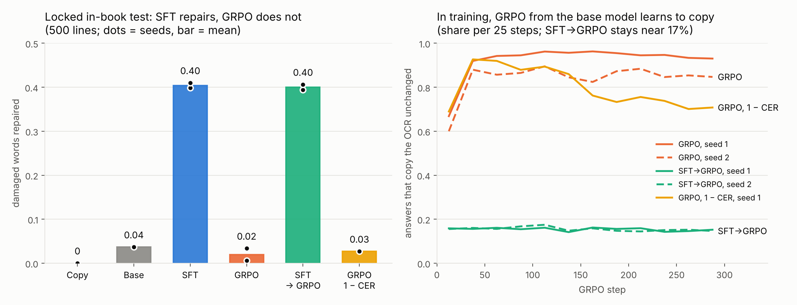

# RL post-training results: repairing historical OCR with SFT and GRPO

*Module 7 of BioEvidenceBench, 2026-11-20 to 2026-11-21. Dekun Sun (design decisions, audits,
reviews, release decision) with Claude (code, runs, analysis). The full record of every step is
`rl/LOG.md` (Chinese: `rl/PLAN_zh.md` section 14). Paths in backticks are relative to the
repository root.*

## Summary

- **Question.** Can a small open model learn to repair legacy BHL OCR, one line at a time, and does
  reinforcement learning with a verifiable reward (GRPO) add anything beyond supervised fine-tuning
  (SFT)?
- **Answer, for Qwen3-0.6B on this task.** SFT works: on 500 locked test lines from the five
  training books it raises the share of damaged words written correctly from **0.04 to 0.40–0.41**,
  scientific names from 0.01 to 0.36–0.44, and keeps more correct words (0.92 → 0.98). **GRPO does
  not**: from the base model it learns to return the OCR unchanged (repair 0.006 / 0.034, below the
  untrained model in seed 1 and on the held-out book); after SFT it adds no repair (Δ −0.004,
  intervals spanning 0 on three test sets) and only breaks fewer correct words (+0.3 points).
- **Why.** GRPO can only reinforce answers the model already produces. The base model's edits are
  right 4% of the time, so "change nothing" is the best policy it can reach under a reward that
  never penalises copying and costs 0.5 per broken word. SFT's gain comes mostly from lines the base
  model never solved in 8 tries: it supplies answers, RL only re-weights them.
- **On an unseen book and language** (Cuvier 1835, French), SFT keeps about half its gain (0.21).
- **The reward had five holes**, two of them found by the author's manual review, not by the automated
  probes. None was exploited by a trained model; one (copying is a safe floor) decided the result.
- **Released**: the SFT seed-2 checkpoint as a research checkpoint,
  [`rl-sft-ocr-repair-v1`](https://github.com/dekunsun/BioEvidenceBench/releases/tag/rl-sft-ocr-repair-v1),
  not for automatic replacement of library text. **GPU spend: about $5.93** of a $20 cap.

## 1. Why this task

The main study found that legacy OCR, not extraction, is where most reliability is lost on these
books, and that an LLM which repairs OCR on the fly (exploratory condition G2) recovers most of it.
This module asks whether a model small enough to run cheaply on all of BHL can learn that repair,
and whether a verifiable reward is a better teacher than the expert transcription itself. The test
it uses is narrower than the main study: line-level OCR repair, scored word by word against the
expert transcription, not downstream extraction F1.

## 2. The environment (task B)

| | |
|---|---|
| Unit | one line of the expert transcription (IMPACT ground truth) paired with the legacy BHL OCR aligned to it, plus the nearest OCR line above and below as context |
| Books | five for training, development and in-book test: Butler 1907 (English), Reeve 1849 (Latin and English), *Horae Societatis Entomologicae Rossicae* 1881 (German, French, Latin, Russian), *Das Chitinskelett von Eosentomon* 1913 (German), *Piscium querelae et vindiciae* 1708 (Latin); **Cuvier 1835 (French) held out**, never read until the test protocol was frozen |
| Split | by contiguous content pages (split v2): train 31,909 lines, dev 3,787, in-book test 3,743 |
| Lines set aside | unreadable characters in the reference, mixed-script words, index lines with leader dots, words the OCR lost and the context cannot supply, confirmed transcription typos (12 checked by the author against the scans, 9 confirmed), 5 manual exclusions |
| Alignment audit | two rounds; the author independently judged 30 pairs: same-line agreement 27 / 28, kappa 0.90 |
| Prompt | `repair_v3`: context lines first, the line to repair last inside `<line>…</line>`, "stop where the marked line ends" (section 4.3) |
| Model | `Qwen/Qwen3-0.6B`, instruct, thinking mode off in every stage (`enable_thinking=False`, one renderer for SFT, GRPO and evaluation) |

**Reward v1.3** (`rl/env/task_b_ocr_repair/REWARD_DESIGN.md`): for a damaged line, the weighted share
of damaged reference words written exactly (scientific names × 3) minus 0.5 per correct word broken
and 0.25 per word inserted, clipped to [−1, 1]; a clean line scores 1 if nothing breaks. Hard gates
score 0: format (empty, several lines, commentary, wrappers, any `<think>` tag), length outside 0.5–1.5×
the reference, poor alignment. Case-only differences are neutral; typographic ligatures, MUFI
characters and apostrophes are folded; punctuation is not scored.

## 3. Design fixed before training (`rl/training/configs/METRICS.md`)

| | |
|---|---|
| Conditions (P0) | Copy (the OCR), A = Base, A′ = Base after a fixed format clean-up, B = SFT, C = GRPO from Base, D = SFT → GRPO; two seeds per trained condition |
| Ablations | P1: C with the reward 1 − CER (one seed). The data ablation (no name oversampling) and the name-weight ablation were dropped, with the author's agreement, before any test result: C learned no names with both, so removing either could not show a difference |
| Primary metrics | damaged-word repair rate; scientific-name exact recovery; correct-word preservation; format-failure rate; raw and after the fixed clean-up |
| Statistics | paired Δ on the same lines, 95% interval from 2,000 bootstrap resamples of page blocks; a claim needs every seed's interval on the same side of 0; preservation by non-inferiority (margin 1 point, "inconclusive" is never a pass) |
| Reward hacking | an answer with reward ≥ 0.75 that violates a requirement checked independently of the reward, confirmed by hand; more than 2% in a condition means the verifier is not reliable for it |
| Budget gates | $2 smoke test, $13 primary runs, $3 ablations and test, $2 reserve; $20 hard cap |

## 4. Development, stage by stage (dev data only)

### 4.1 Calibration and smoke test

| Stage | What it showed | Cost |
|---|---|---|
| Stop test | the pod saves, uploads its results to a git branch, checks the upload, then is deleted | $0.02 |
| Calibration (4th launch; 3 failed on environment set-up) | thinking really off (0 `<think>`); 57% of items give unequal rewards within a group of 8 at T 1.0 (gate ≥ 20%: passed); but mean reward −0.07, pass rate 4%, and **40% of answers run on into the context lines** | $0.20 |
| Smoke test | SFT 0.53 s/step, GRPO 5.8 s/step ($0.14 per 100 steps on an RTX 4090); in 60 steps, GRPO from Base climbed to the copy-the-OCR reward while entropy fell 0.13 → 0.02 and groups without signal rose 59% → 93% | $0.19 |

### 4.2 Why answers ran on

The author asked whether the input boundary was ambiguous. No input contained a newline; the cause was
the prompt layout: v2 put the *next* line last, right before the answer, and sentences flow across
lines, so 70% of run-ons appended the next line.

### 4.3 Prompt v2 vs v3 (a logged development revision, approved by the author before P0)

| Base model, 184 dev items × 8 answers | v2, T 1.0 | v3, T 1.0 | v2, eval decoding | v3, eval decoding |
|---|---|---|---|---|
| Answers running into the context | 41.6% | **1.7%** | 40.8% | **1.6%** |
| Format failures | 2.5% | 0.6% | 1.4% | 0% |
| Mean reward | −0.064 | +0.096 | −0.019 | +0.162 |
| Pass rate | 3.9% | 15.4% | 5.0% | 18.2% |
| Items with unequal rewards (GRPO's signal) | 56.5% | 54.3% | 18.5% | 18.5% |

v3 removed the confound without reducing the learning signal; it is the prompt for every condition.
($0.07; `rl/training/runs/20261121-1756_promptcmp/REPORT.md`.)

### 4.4 Settings fixed before the P0 runs

- Training mix: 4,800 lines; every block of 16 (one GRPO step) holds 8 lines with a damaged
  scientific name, 3 clean lines (19%, the author: "about 20%") and 5 other damaged lines.
- SFT lr 1e-5; GRPO: 8 answers per prompt, 16 prompts per step, T 1.0, `dapo` loss, std scaling per
  group, β = 0, lr 1e-6, vLLM colocated, 300 steps.
- **Float32 master weights** with bf16 autocast: bf16 weights round away most updates at lr 1e-6
  (the smoke test used bf16; the copying it found came back in float32, so it was not a rounding effect).
- A seed-specific order of the 16-line blocks, because TRL gives vLLM the same sampling seed in every
  run.
- A checkpoint every 50 steps, chosen on 500 dev lines by a rule written before the runs: highest
  post-processed repair rate among checkpoints whose preservation is at least Base's minus 0.01.
- **Every GRPO answer logged** with its step and reward, so "learns to copy" can be checked directly.

### 4.5 Primary runs on dev, and the SFT re-run

| Dev, chosen checkpoint | Seed 1 | Seed 2 |
|---|---|---|
| Base repair | 0.061 | 0.061 |
| B, SFT 300 steps | 0.324 | 0.315 |
| **B, SFT 600 steps** (re-run, the author: SFT was still improving at step 300) | **0.358** (step 600) | **0.361** (step 400) |
| C, GRPO from Base | 0.012 | 0.057 |
| D, SFT 600 → GRPO | 0.353 (step 50) | 0.347 (step 50) |
| C-CER, GRPO with 1 − CER (P1) | 0.047 (step 250) | – |

D chose its first checkpoint in both seeds and stayed at or slightly below its SFT start.
Runs: `rl/training/runs/20261121-1832_p0s1`, `_p0s2`, `20261121-2007_sft600s1`, `20261121-2008_sft600s2`,
`20261121-2022_p1cer`; reports `rl/training/runs/STAGE3_P0_REPORT.md`.

## 5. What GRPO did in training (every completion logged)

| | Answers copying the OCR, steps 0–49 → 250–299 | Groups with no reward difference | Entropy | Training reward |
|---|---|---|---|---|
| C, seed 1 | 79% → 93% | 46% → 95% | 0.16 → 0.01 | 0.12 → 0.19 |
| C, seed 2 | 74% → 85% | 55% → 90% | 0.15 → 0.03 | 0.14 → 0.21 |
| C-CER, seed 1 | 81% → 70% (90% at steps 50–99) | 20% → 74% | 0.16 → 0.02 | (1 − CER) 0.85 → 0.86 |
| D, seed 1 | 18% → 18% | 19% → 45% | 0.43 → 0.16 | 0.54 → 0.65 |
| D, seed 2 | 17% → 17% | 24% → 43% | 0.38 → 0.17 | 0.55 → 0.64 |

GRPO from Base collapses onto copying: groups lose all reward variance and the learning signal
disappears. GRPO after SFT keeps editing, and its training reward rises by 0.1 while dev repair does
not move: a rising training reward was not a better repair.

## 6. The locked test (`rl/training/runs/STAGE4_TEST_REPORT.md`)

Frozen before any test line was scored (`rl/training/configs/TEST_PROTOCOL.md` with
`stage4_models.json`, commit `1140608`); run once, 16.6 minutes, $0.25. Sets: 500 in-book lines (100
per book; the 17 lines the alignment audits had displayed left out; 93 pages, 12 page blocks),
500 Cuvier lines (319 pages), and 3,226 further in-book lines for a larger confirmation. Evaluation
decoding T 0.7, top-p 0.8, top-k 20; 8 answers per line, pass@1 over answers 0–3.

### 6.1 Metrics (raw; after the clean-up the numbers differ by at most 0.002)

| Model | In-book repair | Names (22 words) | Preservation | Format failure | Cuvier repair | Cuvier preservation | Larger set repair |
|---|---|---|---|---|---|---|---|
| Copy the OCR | 0 | 0 | 1.000 | 0% | 0 | 1.000 | 0 |
| A. Base (A′ the same) | 0.037 | 0.011 | 0.921 | 4.4% | 0.047 | 0.921 | 0.038 |
| B. SFT s1 / s2 | 0.399 / 0.410 | 0.44 / 0.36 | 0.983 / 0.982 | 0.2 / 0.7% | 0.213 / 0.212 | 0.981 / 0.982 | 0.527 / 0.510 |
| C. GRPO s1 / s2 | 0.006 / 0.034 | 0 / 0 | 0.996 / 0.990 | 0.3 / 0.4% | 0.002 / 0.011 | 0.999 / 0.998 | – |
| D. SFT → GRPO s1 / s2 | 0.394 / 0.406 | 0.42 / 0.33 | 0.986 / 0.987 | 0.2 / 0.4% | 0.200 / 0.209 | 0.983 / 0.985 | 0.525 / 0.508 |
| C-CER s1 | 0.027 | 0 | 0.993 | 0.3% | 0.032 | 0.995 | – |

Cuvier has 10 damaged name words (7 lines), so names there are descriptive.

### 6.2 Pre-registered verdicts

| Question | Comparison | Seed 1 | Seed 2 | Verdict |
|---|---|---|---|---|
| Does GRPO improve the delivered repair? | C − A, in-book | −0.031 [−0.060, −0.016] | −0.003 [−0.011, 0.008] | **No**; seed 1 below Base |
| … content, not only format? | C − A′ | same within 0.002 | | **No** |
| … on the held-out book? | C − A, Cuvier | −0.046 [−0.082, −0.018] | −0.037 [−0.072, −0.011] | **No**; both below Base |
| Does SFT → GRPO add to SFT? | D − B, in-book | −0.004 [−0.020, 0.001] | −0.004 [−0.012, 0.003] | **No** |
| | D − B, larger set | −0.002 [−0.005, 0.001] | −0.002 [−0.010, 0.006] | **No** |
| | D − B, Cuvier | −0.014 [−0.033, 0.010] | −0.003 [−0.017, 0.010] | **No** |
| Preservation, D − B | margin 1 point | +0.003, interval above 0 | +0.004, above 0 | **Pass**, everywhere |
| Names without harm, D − B | | −0.023 [−0.083, 0.038] | −0.034 [−0.096, 0.000] | **No** gain |
| (descriptive) SFT − Base | in-book / Cuvier | +0.362 / +0.166 | +0.373 / +0.165 | intervals well above 0 |
| P1: does a dense reward escape copying? | C-CER − C / C-CER − A, in-book | +0.021 [0.007, 0.039] / −0.010 [−0.030, 0.001] | | slightly better than C, not above Base |

A page-level bootstrap (93 pages, sensitivity only) agrees with every verdict.

### 6.3 Pass rates: a higher pass@1 is not a better repair

| Model | In-book pass@1 | pass@8 | Cuvier pass@1 | pass@8 |
|---|---|---|---|---|
| Copy | 0.478 | 0.478 | 0.752 | 0.752 |
| Base | 0.376 | 0.422 | 0.577 | 0.636 |
| SFT s1 / s2 | 0.561 / 0.554 | 0.612 / 0.598 | 0.703 / 0.710 | 0.758 / 0.768 |
| GRPO s1 / s2 | 0.478 / 0.486 | 0.482 / 0.494 | 0.747 / 0.747 | 0.748 / 0.750 |
| SFT → GRPO s1 / s2 | 0.567 / 0.562 | 0.610 / 0.604 | 0.718 / 0.726 | 0.762 / 0.774 |

GRPO's pass@1 beats Base's only because a copied clean line scores 1: it equals Copy's. After SFT,
GRPO raises pass@1 by under a point and leaves pass@8 unchanged, the pattern Yue et al. (2025,
arXiv 2504.13837) describe: RL makes answers the policy already gives slightly more likely.

## 7. Where the gain came from (7c, `rl/training/results_7c/ATTRIBUTION_7C.md`)

**By error type** (in-book repair rate):

| Damaged word | Words | Base | SFT | GRPO | SFT → GRPO |
|---|---|---|---|---|---|
| Ordinary misread letters | 399 | 0.05 | 0.45–0.47 | 0.01–0.05 | 0.45–0.46 |
| Long s (ſ) | 169 | 0 | 0.32–0.35 | 0 | 0.32–0.35 |
| Split by the OCR | 34 | 0.07 | 0.25–0.29 | 0.02–0.05 | 0.24–0.29 |
| Ligature (æ œ) | 29 | 0 | 0.31–0.39 | 0 | 0.28–0.36 |
| Scientific name | 22 | 0.01 | 0.34–0.43 | 0 | 0.32–0.40 |
| Digit | 9 | 0.03 | 0.22–0.25 | 0 | 0.22–0.25 |

Base never writes the long s or a ligature the OCR lost: these are conventions of the expert edition,
which SFT shows and GRPO would first have to sample.

**By edit behaviour** (in-book): Base edits 50% of lines and only **4%** of its changes are right;
SFT edits 61–62% with 41–43% precision; GRPO from Base edits 7–17%. SFT → GRPO keeps SFT's edits and
repairs but breaks 0.10 instead of 0.13 correct words per answer, which is its preservation gain and
exactly what the −0.5 penalty asks for.

**By difficulty before training**: on the 289 in-book lines Base never got right in 8 tries, SFT
reaches pass@1 0.30 (GRPO 0.12–0.13, almost all from copying clean lines it used to damage).

**The author's reading of 43 test lines** (Base wrong / D right, and the reverse): all 25 "D right" lines
are genuine repairs matching the expert line (misread letters, Latin endings, long s, a ligature
in a subfamily name), and D stops at the line-end hyphen where Base continued. Of 18 "D wrong" lines,
13 change correct words with no support on the line (`Visagapatam` → `Viseugapatam`), 4 apply a
language prior the book does not follow (`valde` → `valdè`, `l'interieur` → `l'intérieur`), and 1 is a
scoring problem (hole H5 below).

## 8. Is the reward trustworthy? (`rl/REWARD_AUDIT.md` part 2)

**Constructed probes** (17 kinds of answer × 585 dev lines): no probe scores above the honest answer.
Held: empty answers, deleting hard words (−0.03, below copying), lower-casing, misspelling one word,
several lines, run-on, commentary, writing the line twice.

| Hole | What it allows | Seen? |
|---|---|---|
| **H1** Copying is a safe floor (0 on a damaged line, never negative; a broken word −0.5; under 1 − CER copying scores 0.81–0.90) | stop repairing | **decided the GRPO result** |
| **H2** One inserted word costs only 0.25 (an invented word on a clean line scores 0.75) | pad lines | Base 2.4% of test answers, trained ≤ 0.15% |
| **H3** Punctuation is not scored | ignore punctuation | 7–12% of answers score 1.0 with different punctuation |
| **H4** A word broken by the line-end hyphen can be finished for free (`au-` → `au-dessus` scores 1.0), *found by the author* | continue the next line's word | Base 43 test answers at 1.0; no trained model; never rewarded in training |
| **H5** Dash glyphs scored inconsistently (`45-46` → `45–46` loses 0.5; 16% of in-book damaged words differ only in a dash glyph), *found by the author* | unfair penalties; credit for learning the edition's dash habit | SFT's repair rate without dash-only words is 0.39 instead of 0.40; no conclusion changes |

**Confirmed reward hacking** (the author judged 30 blind candidates, all violations): **Base 2.2% in-book,
3.4% Cuvier**, above the 2% threshold, so Reward v1.3 is not a reliable judge of the untrained model;
**trained models 0–0.45%**. These are lower bounds (one independent check found the candidates).
Fixes go into Reward v1.4, which is planned and not built (decided so far: all dash glyphs compared
as one class). A strict-xfail test documents H4.

## 9. Release decision (7d, `rl/RELEASE_DECISION.md`)

| | |
|---|---|
| Decision (the author) | publish **B, SFT seed 2** as a research checkpoint; no production use; no further GPU training for now |
| Why B, not D | B meets every pre-registered criterion D meets; D's extra GRPO step buys 0.3 points of preservation and no repair. Seed chosen on dev (0.361 vs 0.358), not on a test result |
| Why not production | 40% repair in-book, 21% on the French book, and about 1.8% of correct words changed: a library would introduce new errors into correct text |
| Pre-release checks | file is the one tested (frozen asset id and size); SHA-256 computed; tar holds only model and tokenizer files; licences (Qwen3-0.6B Apache 2.0, `finebooks/bhl-impact-gt` CC-BY 3.0, all six BHL items not in copyright); model card with results, regressions and out-of-scope use |
| Release | [`rl-sft-ocr-repair-v1`](https://github.com/dekunsun/BioEvidenceBench/releases/tag/rl-sft-ocr-repair-v1): `sft_s2.tar`, 1,203,578,880 bytes, SHA-256 `bfeb5657e7e078d25b1c47c64a8afd2c63c80d5e8bb0594f285d0fafdea16e8c`, tag at training commit `c994ade`; download checked by the author |

## 10. Cost

| Run | Minutes | GPU (estimate from run time) |
|---|---|---|
| Stop test | 1 | $0.02 |
| Calibration, 3 failed launches + 1 success | 13 | $0.20 |
| Smoke test | 13 | $0.19 |
| Prompt v2 vs v3 | 5 | $0.07 |
| P0, seeds 1 and 2 (in parallel) | 87 + 74 | $2.39 |
| SFT 600 re-run, seeds 1 and 2 | 56 + 61 | $1.74 |
| P1 reward ablation | 44 | $0.65 |
| Locked test | 17 | $0.25 |
| Publishing | 3 | $0.03 |
| Pipeline test: repair the 22 sample pages (section 14) | 5 | $0.07 |
| **Total** | | **$5.59 by run time; about $5.93 by RunPod balance** (pod start-up and deletion delays included) |

All on RunPod, mostly Secure RTX 4090 at $0.89/h. Earlier, the task B API trial (Haiku and Opus as
policies on 200 dev items) cost $4.24 of Claude API budget, separately.

## 11. What changed during development, and one deviation

All of these were decided on dev data or before the locked test, and are logged in `rl/LOG.md`:
prompt v2 → v3; training mix with about 20% clean lines; float32 master weights; seed-specific block
order; SFT 300 → 600 steps (B and D re-run); P1 reduced to the reward ablation; Cuvier built with the
automatic rules only (nobody had read it); reward-hacking candidates split into punctuation-only and
word-level, because punctuation is unscored by design. **Deviation:** the plan asked for release
criteria written by the author before the results; none were written separately, so the release decision
applies only the pre-registered decision rules and marks its practical criteria as written afterwards.

## 12. What this cannot show

- One small model, one reward family, 300 GRPO steps at one learning rate, two seeds: "GRPO does not
  help" holds for this setting, not for GRPO in general.
- The in-book test has 12 independent page blocks, so intervals are coarse; Cuvier's name results rest
  on 10 words.
- Line repair is not extraction: the pipeline test (section 14) was designed after unsealing and is exploratory.
- All texts are public and may be in the base model's pre-training data.
- Reward v1.3 ignores punctuation; every metric here inherits that blind spot.

## 13. What it suggests next

1. Start GRPO where the group already contains repairs (SFT checkpoints at several steps, or a
   larger model), measure pass@8 before training, and test whether GRPO's gain grows with it.
2. Reward v1.4: dash glyphs unified (decided), H4 fixed, and a small negative score for a damaged line
   returned unchanged where the line itself shows the repair, so copying is no longer the safe floor;
   probed on dev before any training.
3. Rejection-sampling fine-tuning (keep the SFT model's answers that score 1, train on them) as a
   cheaper alternative to GRPO for the same purpose.
4. ~~Test the released checkpoint inside the extraction pipeline.~~ Done (2026-11-21, exploratory, see
   section 14).

## 14. The released checkpoint inside the extraction pipeline (exploratory)

Legacy OCR of the 22 sample pages repaired line by line by `sft_s2` (greedy, `repair_v3`, 924 lines,
$0.07 on the GPU), then the frozen G1 extraction with Opus on the 16 test pages ($0.25). Value F1 rises
from 0.60 to **0.67** (Butler) and 0.64 to **0.72** (Reeve); paired page bootstrap +0.07 [0.04, 0.10] and
+0.08 [0.02, 0.12]. That is about a fifth of the gap to dots.mocr (0.95 / 0.98) and far below Opus
repairing while it extracts (G2, 0.96 / 0.91). Of 350 primary test mentions it fixed 31 and broke 6, all
6 intact names turned into other plausible names (`B. oreades` → `B. ovoletes`, `LICHT.` → `LINN.`).
A small line-level repair model is not a substitute for re-OCR; if used, the original line must be kept
beside the repair. Rules fixed before the run: `results/sft_repair_pipeline/PLAN.md`; results:
`results/sft_repair_pipeline/REPORT.md`.

## Files

| What | Where |
|---|---|
| Training report (all of the above in one place) | `rl/TRAINING_REPORT.md` |
| Design and decision rules | `rl/training/configs/METRICS.md`, `TEST_PROTOCOL.md`, `stage4_models.json` |
| Environment, reward, data rules | `rl/env/task_b_ocr_repair/` (`REWARD_DESIGN.md`, `SPLIT_V2.md`, `build/`) |
| Code | `rl/training/` (`stage1_calibrate.py`, `stage2_smoke.py`, `stage3_p0.py`, `stage4_test.py`, `analyze_test_7b.py`, `attribution_7c.py`), `src/rl_task_b*.py`, `rl/training/runpod/` |
| Runs | `rl/training/runs/` (one folder per pod run; `STAGE3_P0_REPORT.md`, `STAGE4_TEST_REPORT.md`) |
| Test analysis, attribution | `rl/training/results_test/`, `rl/training/results_7c/` |
| Reward audit, release | `rl/REWARD_AUDIT.md`, `rl/RELEASE_DECISION.md`, `rl/release/` |
| Toy GRPO (7a) | `rl/training/toy_grpo.py`, `rl/training/NOTES_zh.md` |
| Figure | `src/plot_rl.py` → `docs/figures/rl_results.png` |

---

## 中文摘要

- **问题**：一个小型开源模型能否学会逐行修复 BHL 的旧 OCR？在监督微调（SFT）之外，用可验证奖励做强化学习（GRPO）能否再带来提升？
- **结论**（只针对 Qwen3-0.6B 和这个任务）：
  - **SFT 有效**：在 500 行锁定的同书内测试上，受损词修复率从 0.04 提到 0.40–0.41，学名从 0.01 提到 0.36–0.44，保留率从 0.92 升到 0.98。
  - **GRPO 无效**：从原模型直接做 GRPO，模型学会原样照抄 OCR；种子 1 和留出书上的修复率比未训练时还低。SFT 之后再做 GRPO，修复率不变，只是改坏的词少了约四分之一。
- **原因**：GRPO 只能强化模型已经会写出来的答案。原模型的改动只有 4% 是对的，而奖励对照抄从不扣分、改坏一个词扣 0.5，所以"不改"是它能学到的最好策略。SFT 的提升主要来自原模型 8 次都做不对的行：SFT 提供新答案，RL 只是在已有答案之间重新分配概率。
- **留出书**：在没见过的法语书 Cuvier 上，SFT 保留了约一半的提升（0.21）。
- **奖励审计**：找到五个漏洞，其中两个（H4 行末断词续写、H5 横线字形）是作者人工审查时发现的，自动探针没有发现。训练过的模型都没有利用这些漏洞，但"照抄是安全的保底"（H1）直接决定了 GRPO 的结果。经作者确认的钻空子比例：原模型 2.2–3.4%（超过 2% 门槛），训练过的模型 0–0.45%。
- **发布**：SFT 种子 2 作为研究用检查点公开（`rl-sft-ocr-repair-v1`），不可用于自动替换原文。GPU 总花费约 $5.93，上限 $20。
- **下一步可以做的**：从已经能采样到正确修复的起点做 GRPO；奖励 v1.4；拒绝采样微调。
- **接进抽取流程（已做，探索性）**：先用发布的检查点逐行修复旧 OCR，再用冻结的 G1 让 Opus 提取，16 页测试页上 F1 从 0.60 升到 0.67（Butler）、0.64 升到 0.72（Reeve），配对自助法差值 +0.07 / +0.08；现代 OCR（dots.mocr）是 0.95 / 0.98，Opus 边提取边修复（G2）是 0.96 / 0.91。350 个主要字段提及里修好 31 个、改坏 6 个，改坏的都是原本正确的名字被换成别的看似合理的名字。小模型逐行修复不能代替重新 OCR；若要用，必须保留原行供核对（`results/sft_repair_pipeline/REPORT.md`）。
